# LACS — Use Cases and Procedures

**Part of:** [Lift Alarm Communication Standard (LACS)](LACS.md), see there for version and status

Each procedure consists of descriptive text and numbered rules (normative), a sequence diagram and examples (informative). Message properties are specified in:

- [LACS-scaip-xml.md](LACS-scaip-xml.md) — `application/scaip+xml` message properties
- [LACS-lacs-xml.md](LACS-lacs-xml.md) — `application/lacs+xml` message properties

## Contents

- [General rules](#general-rules)
- [scaip+xml Use Cases](#scaipxml-use-cases)
  - [Lift Voice Alarm](#lift-voice-alarm)
  - [Fallback Alarm Strategy (Operator Queueing & Failover)](#fallback-alarm-strategy-operator-queueing--failover)
  - [Test Transmission](#test-transmission)
  - [Power Outage](#power-outage)
  - [Function monitoring and failure notification](#function-monitoring-and-failure-notification)
  - [Electronic Lift Attendant](#electronic-lift-attendant)
- [lacs+xml Use Cases](#lacsxml-use-cases)
  - [Commands that trigger a message](#commands-that-trigger-a-message)
  - [Voice callback](#voice-callback)
  - [Help is on the way](#help-is-on-the-way)
  - [Audio control during a voice call](#audio-control-during-a-voice-call)
  - [Service voice call](#service-voice-call)
  - [Text-based Alarm Communication](#text-based-alarm-communication)
  - [Camera support](#camera-support)

---

## General rules

1. A local unit has at most one lift voice alarm at a time. Alarms of further local units of the controller are separate sessions with their own `asid`. Whether the controller can carry several voice calls at the same time is implementation-defined; the LUC MUST NOT discard an alarm because the voice channel it needs is busy (e.g. a controller with a single voice channel during a call of another local unit): it MUST send the voice request as soon as the running call has ended.
2. A voice channel test runs only while no alarm is open at the controller. A test that falls due during an alarm MUST be postponed until the end of alarm. The LUC MUST answer the command `aid=0213` during an alarm with `snu=12`; no session is opened. The ARC answers a start of voice channel test (`stc=0202`) during an open alarm of the controller with `snu=12`; the LUC then postpones the test in the same way and reports no result. A postponed test starts later with a new `asid`. If the LUC has postponed a voice channel test for longer than `automatic_test_interval`, it MUST report `stc=0203` with a new `asid`, so that the ARC detects a test that cannot run.
3. A lift voice alarm raised during a voice channel test ends the test: the LUC ends the test call, resets the test session (`RE` with the `asid` of the test) and sends the lift voice alarm without waiting for the response to the reset. The test session ends with the response to the reset; the LUC reports no test result.
4. The ARC MUST accept every lift voice alarm. If a local unit sends a lift voice alarm with a new `asid` while an earlier alarm of the same local unit is still open at the ARC (e.g. after a restart of the LUC), the ARC processes the new alarm and keeps the earlier session until its end of alarm. How the ARC closes a session that never receives its end of alarm is implementation-defined.
5. The ARC MUST answer a voice request as soon as it has recorded the session; it does not wait for downstream systems.
6. If a lift voice alarm is raised during a call outside an alarm session, the LUC SHOULD, as far as it is able to: end a service voice call (`stc=0212`) at once and send the voice request of the alarm; keep a callback (`stc=0211`) of the same local unit and send the voice request as soon as the call has ended; end a callback of another local unit that occupies the voice channel needed for the alarm and send the voice request. In any case rule 1 applies. The alarm gets a new `asid`.

## scaip+xml Use Cases

The following use cases use `Content-Type: application/scaip+xml` for signalling.

### Lift Voice Alarm

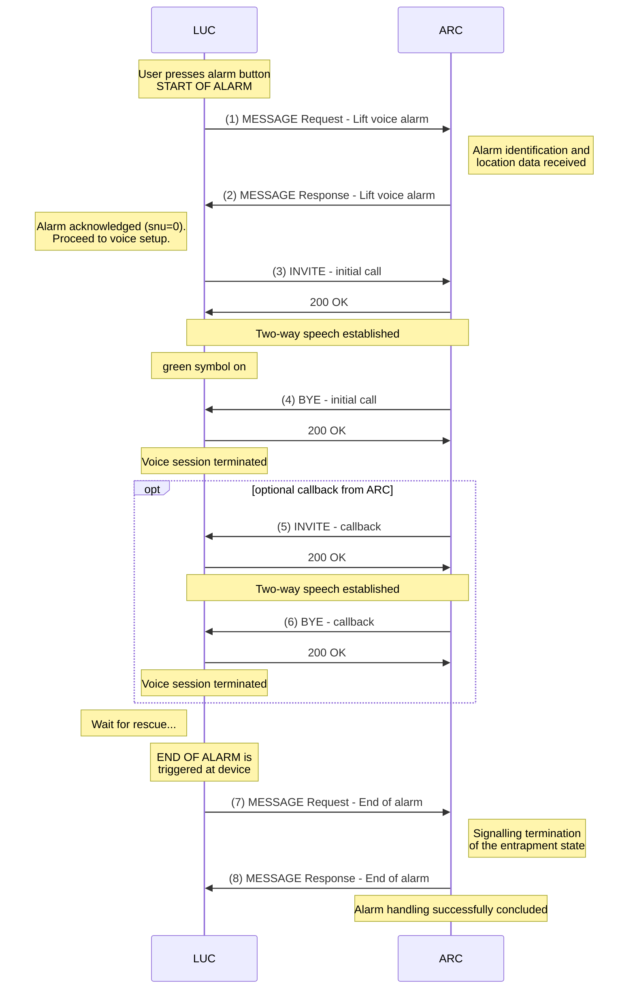

#### Acknowledgement according to EN 81-28

The alarm counts as acknowledged (prEN 81-28:2025 §4.2.4) when the ARC has answered the lift voice alarm (`stc=0010`) with `snu=0`. LACS does not use SIP INFO for acknowledgement.

- Between acknowledgement and end of alarm, alarm filtering is bypassed (prEN 81-28:2025 §4.2.3).
- While the voice call is established, i.e. while its RTP stream is running, the LUC switches on the green graphical symbol (prEN 81-28:2025 §4.2.9 c).
- Before acknowledgement, the LUC re-emits the alarm as fast as possible according to the [Fallback Alarm Strategy](#fallback-alarm-strategy-operator-queueing--failover). If the voice call does not come about after acknowledgement, the LUC continues as in [Voice call after acceptance fails](#voice-call-after-acceptance-fails).
- If an established voice call is interrupted, the LUC does not re-emit the alarm automatically. A new voice call is established when the alarm button is pressed again (new voice request with the same `asid`) or by a callback of the ARC (`aid=0211`), as required by prEN 81-28:2025 §4.2.5.

#### (1) MESSAGE Request - Lift voice alarm

```xml
MESSAGE sip:reception@arc.example.com;transport=tls
...
Content-Type: application/scaip+xml

<mrq>
    <ref>501</ref>
    <pve>LACS/1.0</pve>
    <mty>ME</mty>
    <mreq>1</mreq>
    <cid>14100012345</cid>
    <dty>0101</dty>
    <did>1</did>
    <stc>0010</stc>
    <lco>053</lco>
    <etm>2026-11-04T09:15:02Z</etm>
    <asid>f0af228f-e42f-546e-bd90-d769e074b0ff</asid>
</mrq>
```

#### (2) MESSAGE Response - Lift voice alarm

```xml
MESSAGE sip:14100012345@arc.example.com;transport=tls
...
Content-Type: application/scaip+xml

<mrs>
    <ref>501</ref>
    <pve>LACS/1.0</pve>
    <snu>0</snu>
    <mre>1</mre>
    <cre>62</cre>
    <tnu>sips:operator17@arc.example.com</tnu>
    <asid>f0af228f-e42f-546e-bd90-d769e074b0ff</asid>
</mrs>
```

#### (3) INVITE - initial call

```text
INVITE sips:operator17@arc.example.com

From: <sip:14100012345@arc.example.com>;did=1
To: <sip:operator17@arc.example.com>
Contact: <sips:14100012345@192.0.2.10:5061>
LACS-ASID: f0af228f-e42f-546e-bd90-d769e074b0ff
...
```

#### (4) BYE - initial call

```text
BYE sips:14100012345@192.0.2.10:5061
LACS-ASID: f0af228f-e42f-546e-bd90-d769e074b0ff
...
```

#### (5) INVITE - callback

```text
INVITE sip:14100012345@arc.example.com

From: <sip:operator17@arc.example.com>
To: <sip:14100012345@arc.example.com>;did=1
Contact: <sips:operator17@198.51.100.20:5061>
LACS-ASID: f0af228f-e42f-546e-bd90-d769e074b0ff
...
```

#### (6) BYE - callback

```text
BYE sips:14100012345@192.0.2.10:5061
LACS-ASID: f0af228f-e42f-546e-bd90-d769e074b0ff
...
```

#### (7) MESSAGE Request - End of alarm

```xml
MESSAGE sip:reception@arc.example.com;transport=tls
...
Content-Type: application/scaip+xml

<mrq>
    <ref>502</ref>
    <pve>LACS/1.0</pve>
    <mty>ME</mty>
    <cid>14100012345</cid>
    <dty>0101</dty>
    <did>1</did>
    <stc>0201</stc>
    <lco>053</lco>
    <etm>2026-11-04T09:15:42Z</etm>
    <asid>f0af228f-e42f-546e-bd90-d769e074b0ff</asid>
</mrq>
```

#### (8) MESSAGE Response - End of alarm

```xml
MESSAGE sip:14100012345@arc.example.com;transport=tls
...
Content-Type: application/scaip+xml

<mrs>
    <ref>502</ref>
    <pve>LACS/1.0</pve>
    <snu>0</snu>
    <asid>f0af228f-e42f-546e-bd90-d769e074b0ff</asid>
</mrs>
```

#### Lift voice alarm with alarm filter bypassed

If the alarm filter was bypassed by pressing the alarm button continuously (prEN 81-28:2025 §4.2.3), the voice request carries `ico=001`. If alarm filtering is enabled but no filter criterion applied, it carries `ico=002` (see [info-code (ico)](LACS-scaip-xml.md#info-code-ico)). Everything else is identical to the lift voice alarm above.

```xml
MESSAGE sip:reception@arc.example.com;transport=tls
...
Content-Type: application/scaip+xml

<mrq>
    <ref>601</ref>
    <pve>LACS/1.0</pve>
    <mty>ME</mty>
    <mreq>1</mreq>
    <cid>14100012345</cid>
    <dty>0101</dty>
    <did>1</did>
    <stc>0010</stc>
    <lco>053</lco>
    <ico>001</ico>
    <ite>button held 25 s, car running</ite>
    <etm>2026-11-04T09:16:22Z</etm>
    <asid>399e1d66-537e-50ab-9939-9acabc1afccf</asid>
</mrq>
```

### Fallback Alarm Strategy (Operator Queueing & Failover)

While all operators are busy, the ARC replies with `snu=4` (HOLD) and the LUC retransmits the alarm with a new `ref` and the same `asid`. Once an operator becomes available, the ARC answers with `snu=0` and the operator's URI in `tnu`.

If `alarm_accept_timeout` elapses without `snu=0`, the LUC aborts the alarm at this ARC with `mty=RE` (TS 50134-9 §5.4) and re-routes it to the next server address of `sip_outbound_proxy` (a further server of the ARC or an alternative ARC, see [Server addresses and error handling](LACS.md#server-addresses-and-error-handling)), keeping the same `asid` (same alarm case). The Request-URI stays `alarm_uri`; only the server address changes.

The ARC MUST NOT hold (`snu=4`) a start of voice channel test (`stc=0202`), a single event or a voice request of a callback or service voice call (`stc` 0211, 0212).

If all server addresses have been exhausted, the LUC uses its fallback alarm path, if it has one (outside LACS, see [Purpose](LACS.md#purpose)).

Until the alarm is acknowledged and its voice call is established, the LUC MUST repeat the transmission. If the alarm has not been acknowledged 5 min after it was initiated, the LUC MUST turn to the next configured target at the latest then (prEN 81-28:2025 §4.2.4); a further server address of the same ARC counts as such a target. After the last configured target (server address or fallback alarm path) it starts again with the first one. The retry procedure across the targets is implementation-defined.

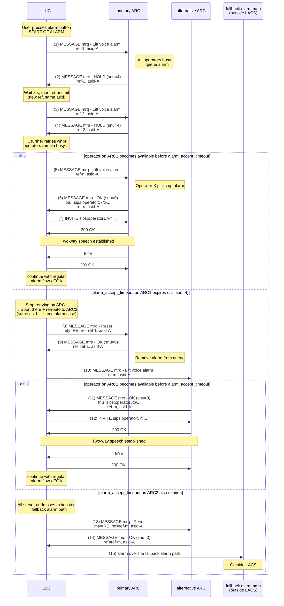

> [!NOTE]
>
> The LUC retransmits after `snu=4` every **5 s** (lower bound of the 5–20 s range in TS 50134-9 §5.2). Step (15) is outside the LACS message flow.

#### (1) MESSAGE Request - Lift voice alarm (initial attempt)

```xml
MESSAGE sip:reception@arc.example.com;transport=tls
...
Content-Type: application/scaip+xml

<mrq>
    <ref>701</ref>
    <pve>LACS/1.0</pve>
    <mty>ME</mty>
    <mreq>1</mreq>
    <cid>14100012345</cid>
    <dty>0101</dty>
    <did>1</did>
    <stc>0010</stc>
    <lco>053</lco>
    <etm>2026-11-04T09:17:02Z</etm>
    <asid>c0414c8e-c0d6-584a-857a-293c92cb343d</asid>
</mrq>
```

#### (2) MESSAGE Response - HOLD (all operators busy)

```xml
MESSAGE sip:14100012345@arc.example.com;transport=tls
...
Content-Type: application/scaip+xml

<mrs>
    <ref>701</ref>
    <pve>LACS/1.0</pve>
    <snu>4</snu>
    <asid>c0414c8e-c0d6-584a-857a-293c92cb343d</asid>
</mrs>
```

#### (3) MESSAGE Request - Lift voice alarm (retry)

```xml
MESSAGE sip:reception@arc.example.com;transport=tls
...
Content-Type: application/scaip+xml

<mrq>
    <ref>702</ref>
    <pve>LACS/1.0</pve>
    <mty>ME</mty>
    <mreq>1</mreq>
    <cid>14100012345</cid>
    <dty>0101</dty>
    <did>1</did>
    <stc>0010</stc>
    <lco>053</lco>
    <etm>2026-11-04T09:17:02Z</etm>
    <asid>c0414c8e-c0d6-584a-857a-293c92cb343d</asid>
</mrq>
```

#### (4) MESSAGE Response - still HOLD

```xml
MESSAGE sip:14100012345@arc.example.com;transport=tls
...
Content-Type: application/scaip+xml

<mrs>
    <ref>702</ref>
    <pve>LACS/1.0</pve>
    <snu>4</snu>
    <asid>c0414c8e-c0d6-584a-857a-293c92cb343d</asid>
</mrs>
```

#### (5) MESSAGE Request - Lift voice alarm (further retry)

```xml
MESSAGE sip:reception@arc.example.com;transport=tls
...
Content-Type: application/scaip+xml

<mrq>
    <ref>720</ref>
    <pve>LACS/1.0</pve>
    <mty>ME</mty>
    <mreq>1</mreq>
    <cid>14100012345</cid>
    <dty>0101</dty>
    <did>1</did>
    <stc>0010</stc>
    <lco>053</lco>
    <etm>2026-11-04T09:17:02Z</etm>
    <asid>c0414c8e-c0d6-584a-857a-293c92cb343d</asid>
</mrq>
```

#### (6) MESSAGE Response - Operator available (snu=0)

```xml
MESSAGE sip:14100012345@arc.example.com;transport=tls
...
Content-Type: application/scaip+xml

<mrs>
    <ref>720</ref>
    <pve>LACS/1.0</pve>
    <snu>0</snu>
    <mre>1</mre>
    <cre>62</cre>
    <tnu>sips:operator17@arc.example.com</tnu>
    <asid>c0414c8e-c0d6-584a-857a-293c92cb343d</asid>
</mrs>
```

#### (7) INVITE - initial call to the assigned operator

```text
INVITE sips:operator17@arc.example.com

From: <sip:14100012345@arc.example.com>;did=1
To: <sip:operator17@arc.example.com>
Contact: <sips:14100012345@192.0.2.10:5061>
LACS-ASID: c0414c8e-c0d6-584a-857a-293c92cb343d
...
```

From here on the flow continues as in the regular *Lift Voice Alarm* use case.

#### (8) MESSAGE Request - Reset of alarm at primary ARC

```xml
MESSAGE sip:reception@arc.example.com;transport=tls
...
Content-Type: application/scaip+xml

<mrq>
    <ref>701</ref>
    <pve>LACS/1.0</pve>
    <mty>RE</mty>
    <cid>14100012345</cid>
    <dty>0101</dty>
    <did>1</did>
    <asid>c0414c8e-c0d6-584a-857a-293c92cb343d</asid>
</mrq>
```

#### (9) MESSAGE Response - Reset acknowledged by primary ARC

```xml
MESSAGE sip:14100012345@arc.example.com;transport=tls
...
Content-Type: application/scaip+xml

<mrs>
    <ref>701</ref>
    <pve>LACS/1.0</pve>
    <snu>0</snu>
    <asid>c0414c8e-c0d6-584a-857a-293c92cb343d</asid>
</mrs>
```

#### (10) MESSAGE Request - Lift voice alarm to alternative ARC

```xml
MESSAGE sip:reception@arc.example.com;transport=tls
...
Content-Type: application/scaip+xml

<mrq>
    <ref>730</ref>
    <pve>LACS/1.0</pve>
    <mty>ME</mty>
    <mreq>1</mreq>
    <cid>14100012345</cid>
    <dty>0101</dty>
    <did>1</did>
    <stc>0010</stc>
    <lco>053</lco>
    <etm>2026-11-04T09:17:02Z</etm>
    <asid>c0414c8e-c0d6-584a-857a-293c92cb343d</asid>
</mrq>
```

#### (11) MESSAGE Response - OK from alternative ARC

```xml
MESSAGE sip:14100012345@arc.example.com;transport=tls
...
Content-Type: application/scaip+xml

<mrs>
    <ref>730</ref>
    <pve>LACS/1.0</pve>
    <snu>0</snu>
    <mre>1</mre>
    <cre>62</cre>
    <tnu>sips:operator5@arc2.example.com</tnu>
    <asid>c0414c8e-c0d6-584a-857a-293c92cb343d</asid>
</mrs>
```

#### (12) INVITE - initial call to the alternative ARC operator

```text
INVITE sips:operator5@arc2.example.com

From: <sip:14100012345@arc.example.com>;did=1
To: <sip:operator5@arc2.example.com>
Contact: <sips:14100012345@192.0.2.10:5061>
LACS-ASID: c0414c8e-c0d6-584a-857a-293c92cb343d
...
```

#### (13) MESSAGE Request - Reset of alarm at alternative ARC

```xml
MESSAGE sip:reception@arc.example.com;transport=tls
...
Content-Type: application/scaip+xml

<mrq>
    <ref>730</ref>
    <pve>LACS/1.0</pve>
    <mty>RE</mty>
    <cid>14100012345</cid>
    <dty>0101</dty>
    <did>1</did>
    <asid>c0414c8e-c0d6-584a-857a-293c92cb343d</asid>
</mrq>
```

#### (14) MESSAGE Response - Reset acknowledged by alternative ARC

```xml
MESSAGE sip:14100012345@arc.example.com;transport=tls
...
Content-Type: application/scaip+xml

<mrs>
    <ref>730</ref>
    <pve>LACS/1.0</pve>
    <snu>0</snu>
    <asid>c0414c8e-c0d6-584a-857a-293c92cb343d</asid>
</mrs>
```

#### (15) Fallback alarm path

The alarm is transmitted over a fallback alarm path of the LUC. Such paths are outside LACS.

#### Voice call after acceptance fails

If the ARC has answered with `snu=0` and `tnu` but the call to `tnu` does not come about (the call is not answered within 30 s, or the SIP call setup fails), the LUC MUST reset the alarm at this ARC with `RE` (the `ref` of the first request, same `asid`, TS 50134-9 §5.4) and continue with the same `asid` at the next server address, finally over its fallback alarm path.

If the local unit is hung up while the alarm is held (`snu=4`) or during the call setup, the LUC MUST send `RE` at this ARC at once. The alarm stays open at the LUC; it ends only with the end of alarm. The LUC does not continue at the next server address or over the fallback alarm path. When the alarm is initiated again at the local unit (e.g. alarm button pressed or handset lifted), it sends a new voice request with the same `asid`.

On `RE` the ARC releases an operator who is waiting for the call, closes the case as handed over and answers `snu=0`.

For a callback outside an alarm (`stc=0211`) and a service voice call (`stc=0212`), a failed call ends the session; the LUC sends no `RE` and uses no fallback alarm path. For a callback within an alarm session (`stc=0010` after `aid=0211`), a failed call neither ends nor moves the alarm: the LUC sends no `RE`, does not continue at the next server address and uses no fallback alarm path, because the alarm is already acknowledged. The alarm session stays open; the ARC MAY send `0211` again.

This is different from an established voice call that drops: then the LUC does not re-emit the alarm automatically (see [Acknowledgement according to EN 81-28](#acknowledgement-according-to-en-81-28)).

### Test Transmission

Every local unit MUST deliver its own test transmission (`stc=0102`, with its `did`) at least once per `automatic_test_interval` (default 72 h). A controller with several local units sends one test transmission per local unit, not one collective message. The answer to the command `aid=0210` remains a single test transmission.

The LUC MUST send the test transmission to `automatic_test_uri`. If `automatic_test_uri` is not configured, it uses `alarm_uri`.

The LUC SHOULD send each test transmission at a random time between 90 % and 100 % of `automatic_test_interval` after the previous one (with the default of 72 h: between 64.8 h and 72 h). The test transmissions of many LUCs, e.g. after a regional power failure, are thus spread over time, and the interval is never exceeded.

A test transmission counts as successful when the ARC has answered it with `snu=0`; with this the ARC acknowledges the lift identification (prEN 81-28:2025 §4.2.8). If no test transmission has succeeded 1 h after the first failed attempt, the LUC MUST indicate the unsuccessful automatic test locally as required by prEN 81-28:2025 §4.2.8, until a test transmission succeeds or a voice request is answered with `snu=0` (prEN 81-28:2025 §4.2.8).

If the ARC has received no test transmission of a local unit for `automatic_test_interval` plus 1 h, it SHOULD inform its operators. It MAY first trigger a test transmission with `aid=0210`.

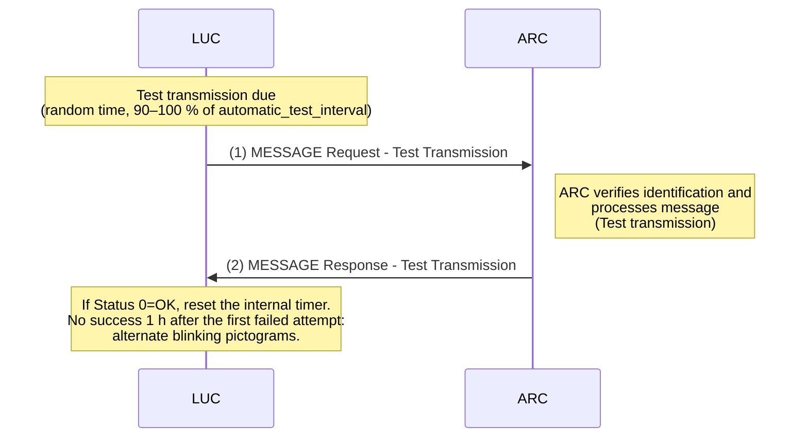

#### (1) MESSAGE Request - Test Transmission

```xml
MESSAGE sip:reception@arc.example.com;transport=tls
...
Content-Type: application/scaip+xml

<mrq>
    <ref>901</ref>
    <pve>LACS/1.0</pve>
    <mty>ME</mty>
    <cid>14100012345</cid>
    <dty>0101</dty>
    <did>1</did>
    <stc>0102</stc>
    <lco>053</lco>
    <etm>2026-11-04T09:17:42Z</etm>
    <npcmf>Example Lift Phones</npcmf>
    <npcty>ELP-GW 200 rev C</npcty>
    <npcfw>3.4.1</npcfw>
    <npchi>356938035643809</npchi>
    <npcms>+447700900123</npcms>
    <nplmf>Example Lift Phones</nplmf>
    <nplty>ELP-CAR 10 rev B</nplty>
    <nplfw>2.1.0</nplfw>
    <asid>8a25acf7-f19b-59a0-b694-289e0dc73eef</asid>
</mrq>
```

#### (2) MESSAGE Response - Test Transmission

```xml
MESSAGE sip:14100012345@arc.example.com;transport=tls
...
Content-Type: application/scaip+xml

<mrs>
    <ref>901</ref>
    <pve>LACS/1.0</pve>
    <snu>0</snu>
    <asid>8a25acf7-f19b-59a0-b694-289e0dc73eef</asid>
</mrs>
```

### Power Outage

#### Short Power Outage

A short outage results in a **failure and a restoration message**.

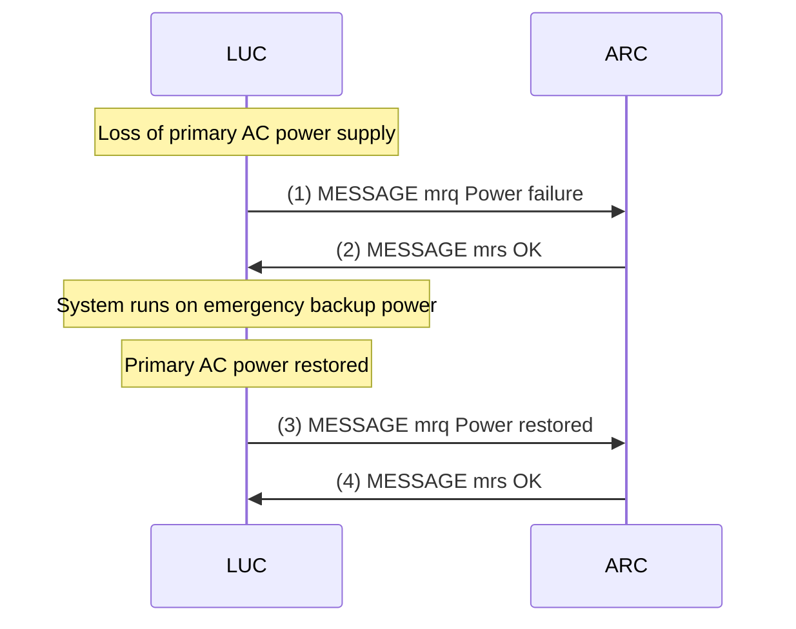

##### (1) MESSAGE mrq — Power failure

```xml
MESSAGE sip:reception@arc.example.com;transport=tls
...
Content-Type: application/scaip+xml

<mrq>
    <ref>1101</ref>
    <pve>LACS/1.0</pve>
    <mty>ME</mty>
    <cid>14100012345</cid>
    <dty>0045</dty>
    <stc>0085</stc>
    <etm>2026-11-04T09:18:22Z</etm>
    <asid>ef0291eb-329a-52c3-9dfa-f8f18fbe3c57</asid>
</mrq>
```

##### (2) MESSAGE mrs — Power failure OK

```xml
MESSAGE sip:14100012345@arc.example.com;transport=tls
...
Content-Type: application/scaip+xml

<mrs>
    <ref>1101</ref>
    <pve>LACS/1.0</pve>
    <snu>0</snu>
    <asid>ef0291eb-329a-52c3-9dfa-f8f18fbe3c57</asid>
</mrs>
```

##### (3) MESSAGE mrq — Power restored

```xml
MESSAGE sip:reception@arc.example.com;transport=tls
...
Content-Type: application/scaip+xml

<mrq>
    <ref>1102</ref>
    <pve>LACS/1.0</pve>
    <mty>ME</mty>
    <cid>14100012345</cid>
    <dty>0045</dty>
    <stc>0086</stc>
    <etm>2026-11-04T09:19:02Z</etm>
    <asid>9b9459a1-f763-5cfe-9a5f-e8caa9e03c7c</asid>
</mrq>
```

##### (4) MESSAGE mrs — Power restored OK

```xml
MESSAGE sip:14100012345@arc.example.com;transport=tls
...
Content-Type: application/scaip+xml

<mrs>
    <ref>1102</ref>
    <pve>LACS/1.0</pve>
    <snu>0</snu>
    <asid>9b9459a1-f763-5cfe-9a5f-e8caa9e03c7c</asid>
</mrs>
```

#### Long Power Outage

If the mains is not restored, the emergency power supply can become critically low.
In this case **no "power restored" message is sent**. Instead:

1. If the LUC can determine the remaining capacity, it MUST send **battery low** (`stc=0016`) when the remaining capacity is only sufficient for about 5 minutes of voice communication (guide value).
2. Immediately before it switches off because the emergency power supply is depleted, the LUC MAY send **out of service** (`stc=0078`). This message is optional, because not every device has enough energy left for a reliable transmission at that point. The LUC does not repeat it and does not delay switching off for it.

When the mains returns, the LUC sends **power restored** (`stc=0086`) as usual and later **battery charged** (`stc=0015`).

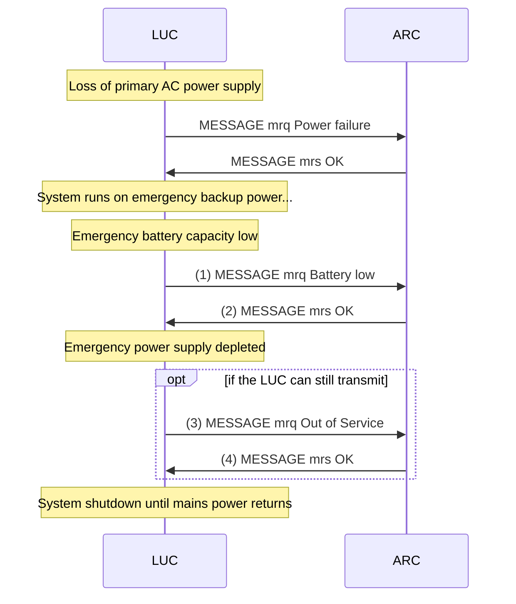

##### (1) MESSAGE mrq — Battery low

```xml
MESSAGE sip:reception@arc.example.com;transport=tls
...
Content-Type: application/scaip+xml

<mrq>
    <ref>1203</ref>
    <pve>LACS/1.0</pve>
    <mty>ME</mty>
    <cid>14100012345</cid>
    <dty>0045</dty>
    <stc>0016</stc>
    <etm>2026-11-04T09:19:42Z</etm>
    <asid>e7c46c7c-4025-5b2b-a7e1-1fd3e0c39448</asid>
</mrq>
```

##### (2) MESSAGE mrs — Battery low ACK

```xml
MESSAGE sip:14100012345@arc.example.com;transport=tls
...
Content-Type: application/scaip+xml

<mrs>
    <ref>1203</ref>
    <pve>LACS/1.0</pve>
    <snu>0</snu>
    <asid>e7c46c7c-4025-5b2b-a7e1-1fd3e0c39448</asid>
</mrs>
```

##### (3) MESSAGE mrq — Out of Service

```xml
MESSAGE sip:reception@arc.example.com;transport=tls
...
Content-Type: application/scaip+xml

<mrq>
    <ref>1204</ref>
    <pve>LACS/1.0</pve>
    <mty>ME</mty>
    <cid>14100012345</cid>
    <dty>0045</dty>
    <stc>0078</stc>
    <etm>2026-11-04T09:20:22Z</etm>
    <asid>f9cdc4ba-191f-544f-bc1e-767b48fd9d37</asid>
</mrq>
```

##### (4) MESSAGE mrs — Out of Service OK

```xml
MESSAGE sip:14100012345@arc.example.com;transport=tls
...
Content-Type: application/scaip+xml

<mrs>
    <ref>1204</ref>
    <pve>LACS/1.0</pve>
    <snu>0</snu>
    <asid>f9cdc4ba-191f-544f-bc1e-767b48fd9d37</asid>
</mrs>
```

### Function monitoring and failure notification

The LUC checks its functions in two ways:

| Kind | Characteristic | Examples | Messages |
| ---- | -------------- | -------- | -------- |
| **Periodic test** | The LUC actively triggers the function itself, at long intervals (guide value: every 24 h or less often, e.g. daily or every 72 h) | voice channel test, alarm button (via actuator), microphone and speaker (test tone), battery test (e.g. under load) | every result: passed or failed |
| **Continuous monitoring** | The function is supervised passively, continuously or at short intervals | internal bus, mains power, battery voltage, communication links | changes of state only: failure and, where TS 50134-9 has a code for it, restoration |

The kind of check decides, not only its interval. The same function can have both, e.g. continuous monitoring of the battery voltage and in addition a periodic battery test. Continuous monitoring produces no "passed" messages, as these would flood the ARC without adding information.

| To be checked | Kind | Requirement | Passed | Failed |
| ------------- | ---- | ----------- | ------ | ------ |
| Voice channel towards the ARC | Periodic test | Mandatory, using the voice channel test sequence (see below) | `stc` = 0207 | `stc` = 0203 |
| Alarm button at the local unit | Periodic test | Optional - only possible with special hardware such as a remotely operated button | `dco` = 002 to 006<br />`stc` = 0208 | `dco` = 002 to 006<br />`stc` = 0204 |
| Microphone and loudspeaker at the local unit | Periodic test | Optional - audio signal played through the speaker is received by the microphone at appropriate level | `dco` = 002 to 006<br />`stc` = 0209 | `dco` = 002 to 006<br />`stc` = 0205 |
| Emergency power supply (battery test) | Periodic test | Optional - for LUCs that test the battery periodically | `stc` = 0210 | `stc` = 0014 |
| Emergency power supply (condition) | Continuous monitoring | Mandatory according to prEN 81-28:2025 §4.2.7 | – | `stc` = 0014 |
| Internal bus between local units and controller | Continuous monitoring | Optional | – | `dty` = 0032<br />`stc` = 0206 |

Rules:

1. The LUC MUST perform the periodic tests at least once per `automatic_test_interval`. Every local unit delivers its own test transmission (see [Test Transmission](#test-transmission)).
2. For every periodic test it performs, the LUC MUST report the result: the "passed" code or the "failed" code. It MAY omit a result only if the device cannot determine or report it, e.g. an older alarm telephone operated as local unit in a retrofit installation.
3. When continuous monitoring detects a failure, the LUC MUST report it immediately.
4. If a failure found by a periodic test persists at the next periodic test, the LUC MUST report it again with a new `asid`.
5. A local unit with several voice units reports the result of the microphone and speaker test for each voice unit separately, with its `dco`.
6. The LUC MUST keep every single event (e.g. a failure, restoration, power or battery report) until the ARC has answered it with a `snu` other than 4, 5 or 6, and MUST repeat it until then with increasing backoff (guide value: from 10 s, doubling up to 1 h); it SHOULD vary each backoff time randomly by up to ±10 %. A repetition keeps the `asid`; within 600 s it also keeps the `ref` (see [Message exchange](LACS-scaip-xml.md#message-exchange)), afterwards it gets a new `ref`. The LUC SHOULD keep pending single events across a restart (non-volatile memory). Exception: out of service (`stc=0078`) is sent at most once and not repeated. For the event time see [event-time (etm)](LACS-scaip-xml.md#event-time-etm).

#### Generic Sequence diagram

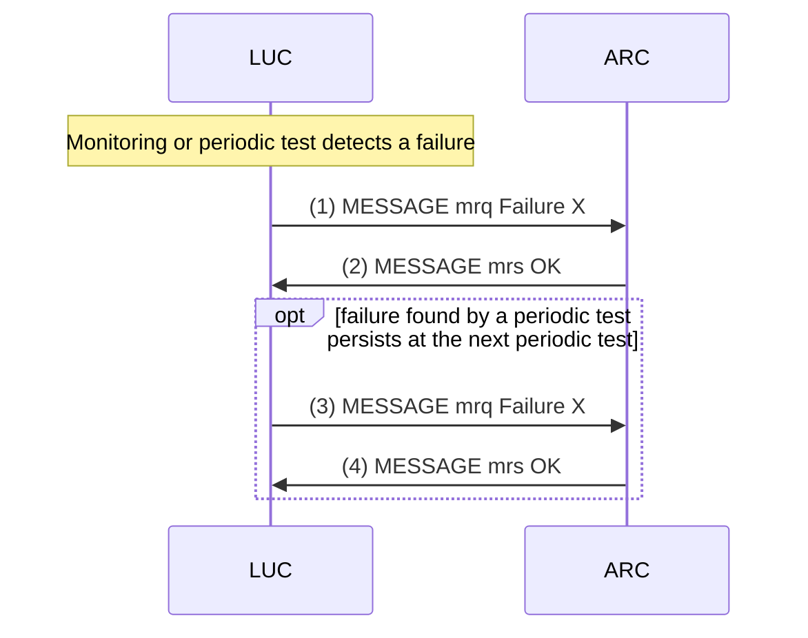

---

#### Example: Battery Failure (0014)

Here the failure is found by the periodic battery test. A failure found by continuous monitoring is reported once, when the state changes (rule 3).

##### (1) MESSAGE mrq - Battery failure

```xml
MESSAGE sip:reception@arc.example.com;transport=tls
...
Content-Type: application/scaip+xml

<mrq>
    <ref>1501</ref>
    <pve>LACS/1.0</pve>
    <mty>ME</mty>
    <cid>14100012345</cid>
    <dty>0045</dty>
    <stc>0014</stc>
    <etm>2026-11-04T09:21:02Z</etm>
    <asid>a8e921df-ada7-5563-a76a-f0d5113dab87</asid>
</mrq>
```

##### (2) MESSAGE mrs OK

```xml
MESSAGE sip:14100012345@arc.example.com;transport=tls
...
Content-Type: application/scaip+xml

<mrs>
    <ref>1501</ref>
    <pve>LACS/1.0</pve>
    <snu>0</snu>
    <asid>a8e921df-ada7-5563-a76a-f0d5113dab87</asid>
</mrs>
```

The periodic battery test fails again at the next test, 24 h later.

##### (3) MESSAGE mrq - Battery failure

```xml
MESSAGE sip:reception@arc.example.com;transport=tls
...
Content-Type: application/scaip+xml

<mrq>
    <ref>1502</ref>
    <pve>LACS/1.0</pve>
    <mty>ME</mty>
    <cid>14100012345</cid>
    <dty>0045</dty>
    <stc>0014</stc>
    <etm>2026-11-05T09:21:42Z</etm>
    <asid>a495f883-2c7f-5747-b4c2-6184be86b27b</asid>
</mrq>
```

##### (4) MESSAGE mrs OK

```xml
MESSAGE sip:14100012345@arc.example.com;transport=tls
...
Content-Type: application/scaip+xml

<mrs>
    <ref>1502</ref>
    <pve>LACS/1.0</pve>
    <snu>0</snu>
    <asid>a495f883-2c7f-5747-b4c2-6184be86b27b</asid>
</mrs>
```

#### SIP Voice Channel Test Sequence

The voice channel test is initiated by the LUC but deliberately inverts the audio roles: the **ARC sends the test tone and the LUC echoes it back**, so the **ARC performs the quality assessment**. This keeps the LUC implementation minimal (embedded resources are limited) and ensures that signal evaluation is performed uniformly across devices from different manufacturers by a single authority.

The LUC starts the test with `stc=0202`. The ARC reports the test result to the LUC in the `Reason` header of the BYE. The LUC then always reports the result to the ARC with the `asid` of the test (unless a lift voice alarm ends the test, see [General rules](#general-rules)), at the latest 30 s after the end of the test call: `stc=0207` if the test has passed, `stc=0203` whenever it cannot complete the voice channel test successfully — regardless of where the failure occurred. `stc=0203` covers in particular:

- the initial `MESSAGE` (1) is rejected (`snu ≠ 0`, except `snu=12` during an open alarm, see [General rules](#general-rules)) or not answered at all,
- the `INVITE` (3) does not succeed (no `200 OK`, final 4xx–6xx response, or transaction timeout), so no media session is established,
- the ARC ends the session with a `BYE` (4) whose `Reason` indicates a failure (`cause=603`),
- the test call ends in any other way without a `BYE` of the ARC with `cause=200`, e.g. the LUC ends the call itself after 30 s, the `BYE` carries no `Reason`, or `cause` is neither 200 nor 603.

If the initial setup of the test fails — the `MESSAGE` (1) after the repetitions of [Message exchange](LACS-scaip-xml.md#message-exchange), or the `INVITE` (3) — the LUC SHOULD start up to 2 further test runs (new `ref`, same `asid`), each after a random wait between 30 s and 120 s, before reporting `stc=0203`; it MUST NOT start more than 2. Further test runs continue the session of the test, also after a reset (`RE`) of a run. This avoids spurious failure reports caused by transient network conditions, and the retries of many LUCs do not coincide. Once the BYE with `Reason=cause=603` has been received, the result is definitive and the LUC reports `stc=0203` without further retries.

This is intentional: the ARC is often a distributed system in which the media endpoint that runs the echo evaluation is not necessarily the component connected to the AMS. Routing the result back through the LUC ensures that voice channel results are reported on the same path as all other results of periodic tests (alarm button, microphone and speaker, battery).

Echo loop and timing:

1. As soon as the voice channel test call is established, the LUC MUST send received audio straight back (RTP loopback) for the whole call. Microphone and speaker of the local units are muted; echo cancellation, noise suppression and automatic gain control of the transmit path are off. The test runs in the controller, not in a local unit. If the loop cannot be engaged, the LUC still sets up the call and reports `stc=0203` afterwards.
2. The ARC MUST release the call when the evaluation is done, at the latest 30 s after answering. The LUC MUST end the call if it is still up 30 s after it was established.
3. A voice alarm call never carries the echo loop, so that the trapped person is heard from the first second.

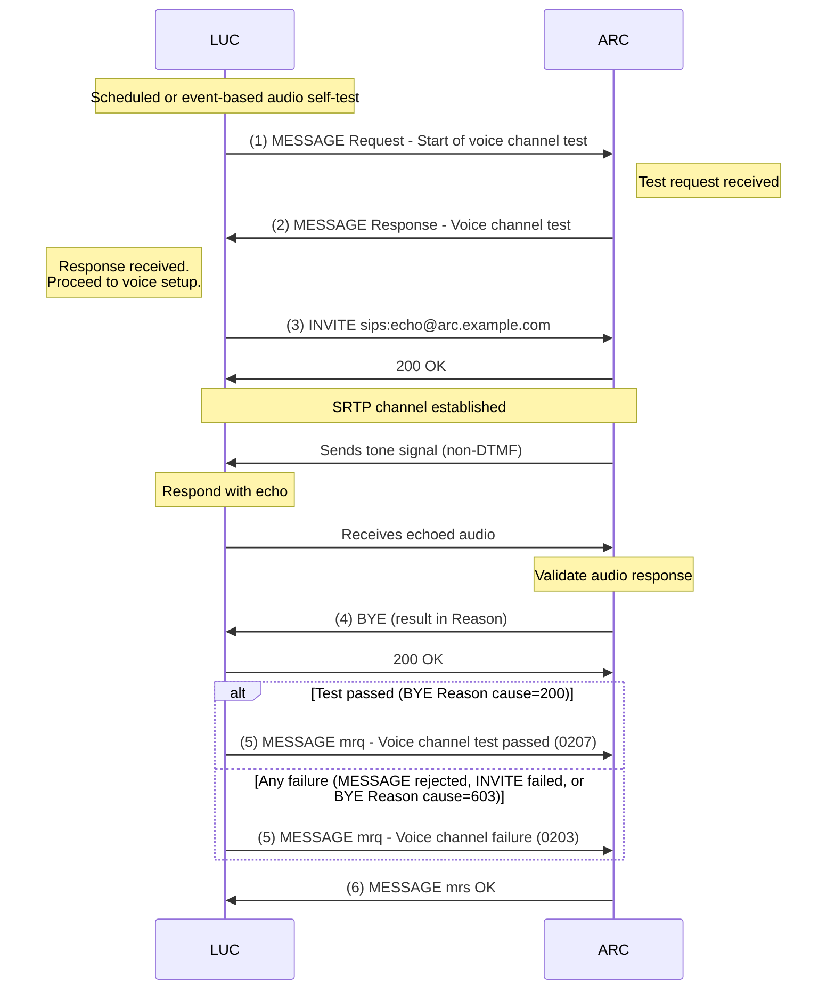

##### (1) MESSAGE Request - Voice channel test

```xml
MESSAGE sip:reception@arc.example.com;transport=tls
...
Content-Type: application/scaip+xml

<mrq>
    <ref>1601</ref>
    <pve>LACS/1.0</pve>
    <mty>ME</mty>
    <mreq>1</mreq>
    <cid>14100012345</cid>
    <dty>0045</dty>
    <stc>0202</stc>
    <etm>2026-11-04T09:22:22Z</etm>
    <asid>03afa876-2931-5dff-9458-c49f2d8de262</asid>
</mrq>
```

##### (2) MESSAGE Response - Voice channel test

```xml
MESSAGE sip:14100012345@arc.example.com;transport=tls
...
Content-Type: application/scaip+xml

<mrs>
    <ref>1601</ref>
    <pve>LACS/1.0</pve>
    <snu>0</snu>
    <mre>1</mre>
    <cre>62</cre>
    <tnu>sips:echo@arc.example.com</tnu>
    <asid>03afa876-2931-5dff-9458-c49f2d8de262</asid>
</mrs>
```

##### (3) INVITE Request — Echo Test

```text
INVITE sips:echo@arc.example.com SIP/2.0
From: <sip:14100012345@arc.example.com>
To: <sip:echo@arc.example.com>
Contact: <sips:14100012345@192.0.2.10:5061>
LACS-ASID: 03afa876-2931-5dff-9458-c49f2d8de262
...
```

##### (4) BYE Request — Echo Test Termination

```text
BYE sips:14100012345@192.0.2.10:5061 SIP/2.0
Via: SIP/2.0/TLS 198.51.100.20:5061;branch=z9hG4bK-bye222
From: <sip:echo@arc.example.com>;tag=arc987
To: <sip:14100012345@arc.example.com>;tag=abc123
LACS-ASID: 03afa876-2931-5dff-9458-c49f2d8de262
Reason: SIP;cause=200;text="Test passed"
...
```

The ARC conveys the test outcome to the LUC in the `Reason` header of the BYE (as defined in RFC 3326). The `cause` value indicates pass (`200`) or fail (`603`); the `text` field carries the result text. The text SHOULD begin with one of the result texts in the following table and MAY be followed by a semicolon, a space and a free diagnostic text. The texts are suggestions for diagnosis; the LUC evaluates only the `cause` value and MUST NOT depend on the text.

| Category                     | cause | text |
| ---------------------------- | ----- | ---- |
| Success                      | 200   | `Test passed` |
| Audio path                   | 603   | `Test failed: no RTP received` |
| Audio path                   | 603   | `Test failed: no echo received` |
| Audio path                   | 603   | `Test failed: one-way audio (no TX)` |
| Audio path                   | 603   | `Test failed: one-way audio (no RX)` |
| Audio path                   | 603   | `Test failed: RTP timeout` |
| Signal quality               | 603   | `Test failed: signal level too low` |
| Signal quality               | 603   | `Test failed: signal level too high (clipping)` |
| Signal quality               | 603   | `Test failed: SNR below threshold` |
| Signal quality               | 603   | `Test failed: excessive noise` |
| Tone/frequency detection     | 603   | `Test failed: tone not detected` |
| Tone/frequency detection     | 603   | `Test failed: frequency mismatch` |
| Tone/frequency detection     | 603   | `Test failed: tone distortion` |
| Tone/frequency detection     | 603   | `Test failed: THD exceeded` |
| Timing                       | 603   | `Test failed: echo delay too high` |
| Timing                       | 603   | `Test failed: jitter exceeded` |
| Timing                       | 603   | `Test failed: tone duration mismatch` |
| Transport                    | 603   | `Test failed: packet loss exceeded` |
| Transport                    | 603   | `Test failed: RTP sequence errors` |
| Transport                    | 603   | `Test failed: codec mismatch` |
| Flow/logic                   | 603   | `Test failed: ARC did not start tone sequence` |
| Flow/logic                   | 603   | `Test failed: echo loop not activated` |
| Flow/logic                   | 603   | `Test failed: test timeout` |
| Generic fallback             | 603   | `Test failed` |

##### (5) MESSAGE mrq - Voice channel test result

Test passed; on failure `stc` is `0203`.

```xml
MESSAGE sip:reception@arc.example.com;transport=tls
...
Content-Type: application/scaip+xml

<mrq>
    <ref>1602</ref>
    <pve>LACS/1.0</pve>
    <mty>ME</mty>
    <cid>14100012345</cid>
    <dty>0045</dty>
    <stc>0207</stc>
    <etm>2026-11-04T09:23:02Z</etm>
    <asid>03afa876-2931-5dff-9458-c49f2d8de262</asid>
</mrq>
```

##### (6) MESSAGE mrs OK

```xml
MESSAGE sip:14100012345@arc.example.com;transport=tls
...
Content-Type: application/scaip+xml

<mrs>
    <ref>1602</ref>
    <pve>LACS/1.0</pve>
    <snu>0</snu>
    <asid>03afa876-2931-5dff-9458-c49f2d8de262</asid>
</mrs>
```

### Electronic Lift Attendant

Optional extension, see [Optional extension: Electronic lift attendant](LACS-scaip-xml.md#optional-extension-electronic-lift-attendant) in LACS-scaip-xml.md. Example: car light failure.

```xml
MESSAGE sip:reception@arc.example.com;transport=tls
...
Content-Type: application/scaip+xml

<mrq>
    <ref>1701</ref>
    <pve>LACS/1.0</pve>
    <mty>ME</mty>
    <cid>14100012345</cid>
    <dty>0045</dty>
    <stc>0994</stc>
    <etm>2026-11-04T09:23:42Z</etm>
    <asid>5ef71a08-0a37-5f41-a3e5-b8ee1f9ec420</asid>
</mrq>
```

---

## lacs+xml Use Cases

The following use cases use `Content-Type: application/lacs+xml` for the extended communication. They always occur within a session: an alarm session initiated via `scaip+xml`, or a session opened by a command of the ARC (`aid` 0210, 0211, 0213, 0223, see [alert-session-id (asid)](LACS-scaip-xml.md#alert-session-id-asid)).

### Commands that trigger a message

Several commands of the ARC take effect as a message of the LUC: `0210` (test transmission `stc=0102`), `0211` (voice request), `0212` (end of alarm `stc=0201`), `0213` (start of voice channel test `stc=0202`) and `0223` (voice request `stc=0212`). The LUC confirms the command at once and sends the message after its internal steps, e.g. after it has connected the local unit over the internal bus. The rules are given in [status-number (snu)](LACS-lacs-xml.md#status-number-snu) (rules 5 and 6).

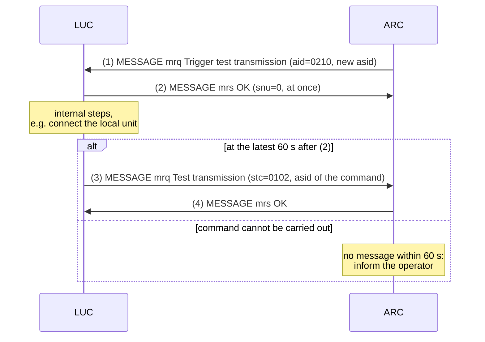

- The LUC never answers a command with `snu=4`, and the ARC does not repeat a confirmed command. A command that cannot be carried out at all is answered at once with `snu=11`, `12` or `3`.
- `0212`: the message is the end of alarm (`stc=0201`) with the `asid` of the alarm, see (7) in [Lift Voice Alarm](#lift-voice-alarm).
- `0213`: the message is the start of the voice channel test (`stc=0202`) with the `asid` of the command; the test then runs as in [SIP Voice Channel Test Sequence](#sip-voice-channel-test-sequence). During a lift voice alarm the LUC answers `0213` with `snu=12` (see [General rules](#general-rules)).
- `0211` and `0223`: see [Voice callback](#voice-callback) and [Service voice call](#service-voice-call).

#### (1) MESSAGE Request - Trigger test transmission

```xml
MESSAGE sip:14100012345@arc.example.com;transport=tls
...
Content-Type: application/lacs+xml

<mrq>
    <ref>1901</ref>
    <pve>LACS/1.0</pve>
    <mty>CO</mty>
    <aid>0210</aid>
    <cid>14100012345</cid>
    <did>1</did>
    <asid>f03494d3-c031-51b3-85d2-cf1cebce28c6</asid>
</mrq>
```

#### (2) MESSAGE Response - Trigger test transmission

```xml
MESSAGE sip:reception@arc.example.com;transport=tls
...
Content-Type: application/lacs+xml

<mrs>
    <ref>1901</ref>
    <pve>LACS/1.0</pve>
    <snu>0</snu>
    <asid>f03494d3-c031-51b3-85d2-cf1cebce28c6</asid>
</mrs>
```

#### (3) MESSAGE Request - Test transmission

```xml
MESSAGE sip:reception@arc.example.com;transport=tls
...
Content-Type: application/scaip+xml

<mrq>
    <ref>1902</ref>
    <pve>LACS/1.0</pve>
    <mty>ME</mty>
    <cid>14100012345</cid>
    <dty>0101</dty>
    <did>1</did>
    <stc>0102</stc>
    <lco>053</lco>
    <etm>2026-11-04T09:24:22Z</etm>
    <npcmf>Example Lift Phones</npcmf>
    <npcty>ELP-GW 200 rev C</npcty>
    <npcfw>3.4.1</npcfw>
    <npchi>356938035643809</npchi>
    <npcms>+447700900123</npcms>
    <nplmf>Example Lift Phones</nplmf>
    <nplty>ELP-CAR 10 rev B</nplty>
    <nplfw>2.1.0</nplfw>
    <asid>f03494d3-c031-51b3-85d2-cf1cebce28c6</asid>
</mrq>
```

#### (4) MESSAGE Response - Test transmission

```xml
MESSAGE sip:14100012345@arc.example.com;transport=tls
...
Content-Type: application/scaip+xml

<mrs>
    <ref>1902</ref>
    <pve>LACS/1.0</pve>
    <snu>0</snu>
    <asid>f03494d3-c031-51b3-85d2-cf1cebce28c6</asid>
</mrs>
```

### Voice callback

With `aid=0211` the ARC requests a voice call with a local unit, e.g. when the voice call of an alarm has dropped, when the `asid` of an alarm is lost (e.g. after a restart of the controller) or for service. The LUC places the call.

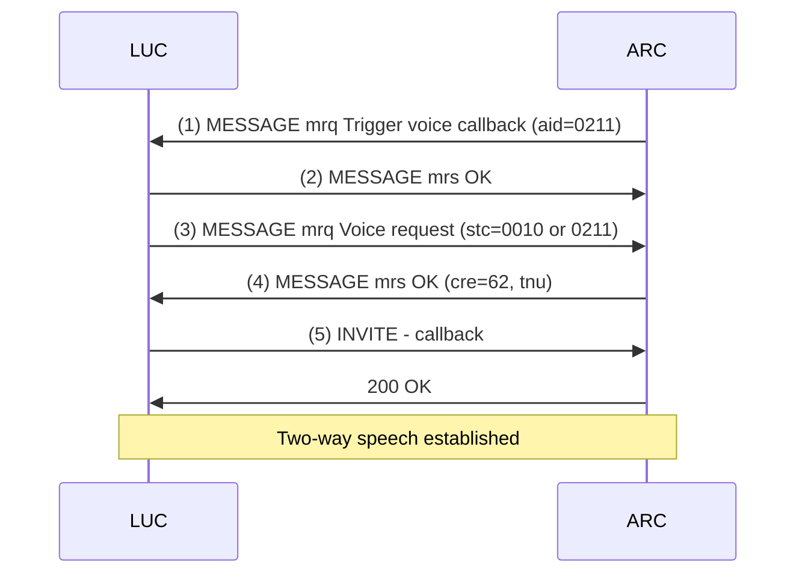

1. The ARC MUST send `0211` only while no call of the session is being set up, ringing or connected. The command MUST include `did`.
2. Within a running alarm session the command carries the `asid` of the alarm. The LUC MUST confirm the command and then send a voice request (`stc=0010`, `mreq=1`) with the same `asid` and a new `ref`. This voice request is a repetition of the alarm: it carries the `etm` of the alarm and no `ico`.
3. Outside an alarm session the ARC creates a new `asid`; the command opens a session of its own. The LUC MUST confirm the command and then send a voice request `stc=0211` (voice call requested by the ARC) with `mreq=1`, the `did` and the `asid` of the command. The session ends with the end of the call.
4. The ARC answers the voice request with `snu=0`, `mre=1`, `cre=62` and `tnu`; it MUST NOT hold it (`snu=4`). The LUC calls `tnu` (INVITE with `LACS-ASID` and `did`, see [Addressing](LACS.md#addressing)). The ARC connects the call with the operator who requested the callback.
5. Within an alarm session the ARC MAY instead call the LUC directly with an INVITE carrying `LACS-ASID` (see (5) in [Lift Voice Alarm](#lift-voice-alarm)).
6. If the LUC cannot assign the callback to a running alarm session (a callback outside an alarm session, or an `asid` it does not know while the local unit has no open alarm), it SHOULD play attention tones at the voice unit throughout the call, e.g. a short beep at regular intervals (sound and interval implementation-defined), so that persons in the car are not listened to without their knowledge, while the voice communication between the ARC and the persons in the car remains possible.
7. The LUC MUST NOT reject `0211` because it does not know the `asid` (e.g. after a restart during an alarm). If the local unit named by `did` has an open alarm of its own, the LUC treats the command as a callback within this alarm (rule 2, with the `asid` of its alarm) and plays no attention tones. Otherwise such a command is a callback outside an alarm session, and the LUC proceeds as in rule 3 with the `asid` of the command. The ARC can thus still assign the call to its alarm. The command arrives over the authenticated connection of the ARC.
8. If the voice channel needed for the call is busy (e.g. a call of another local unit), the LUC MUST answer `0211` with `snu=12` and MUST NOT carry out the command.

#### (1) MESSAGE Request - Trigger voice callback

```xml
MESSAGE sip:14100012345@arc.example.com;transport=tls
...
Content-Type: application/lacs+xml

<mrq>
    <ref>2001</ref>
    <pve>LACS/1.0</pve>
    <mty>CO</mty>
    <aid>0211</aid>
    <cid>14100012345</cid>
    <did>1</did>
    <asid>1f64f007-c86d-5e66-ad86-f947da8f6d3e</asid>
</mrq>
```

#### (2) MESSAGE Response - Trigger voice callback

```xml
MESSAGE sip:reception@arc.example.com;transport=tls
...
Content-Type: application/lacs+xml

<mrs>
    <ref>2001</ref>
    <pve>LACS/1.0</pve>
    <snu>0</snu>
    <asid>1f64f007-c86d-5e66-ad86-f947da8f6d3e</asid>
</mrs>
```

#### (3) MESSAGE Request - Voice request outside an alarm

Within an alarm session `stc` is `0010` with the `asid` of the alarm.

```xml
MESSAGE sip:reception@arc.example.com;transport=tls
...
Content-Type: application/scaip+xml

<mrq>
    <ref>2002</ref>
    <pve>LACS/1.0</pve>
    <mty>ME</mty>
    <mreq>1</mreq>
    <cid>14100012345</cid>
    <dty>0101</dty>
    <did>1</did>
    <stc>0211</stc>
    <etm>2026-11-04T09:25:02Z</etm>
    <asid>1f64f007-c86d-5e66-ad86-f947da8f6d3e</asid>
</mrq>
```

#### (4) MESSAGE Response - Voice request

```xml
MESSAGE sip:14100012345@arc.example.com;transport=tls
...
Content-Type: application/scaip+xml

<mrs>
    <ref>2002</ref>
    <pve>LACS/1.0</pve>
    <snu>0</snu>
    <mre>1</mre>
    <cre>62</cre>
    <tnu>sips:operator17@arc.example.com</tnu>
    <asid>1f64f007-c86d-5e66-ad86-f947da8f6d3e</asid>
</mrs>
```

#### (5) INVITE - callback

```text
INVITE sips:operator17@arc.example.com

From: <sip:14100012345@arc.example.com>;did=1
To: <sip:operator17@arc.example.com>
Contact: <sips:14100012345@192.0.2.10:5061>
LACS-ASID: 1f64f007-c86d-5e66-ad86-f947da8f6d3e
...
```

### Help is on the way

The ARC SHOULD send the command "Help is on the way" (`mty=CO`, `aid=0214`) to the LUC once per alarm session, as soon as it has initiated the rescue of the trapped persons. Whether and when it does so depends on the processes of the ARC. If the LUC has announced a TBUI (`cap` contains `0011`), the ARC MUST send it (see [Text-based Alarm Communication](#text-based-alarm-communication)).

The LUC confirms receipt with `snu=0` and decides how it presents the information, depending on its hardware: as predefined text on a TBUI in the selected language, by a status indication such as a LED or a pictogram, by an announcement, or not at all. It keeps presenting the information until the end of alarm.

### Audio control during a voice call

LACS does not use SIP INFO (see [SIP methods](LACS.md#sip-methods)). The ARC controls the voice call with the `lacs+xml` commands `0215` to `0219`, `0221`, `0222` and `0224` (see [action-id (aid)](LACS-lacs-xml.md#action-id-aid)), so that every action is identified by `ref` and `asid`, confirmed by a response and traceable.

1. The commands are valid only while a voice call of the session (`asid`) is established, e.g. in a lift alarm, a callback or a service voice call.
2. A command without `dco` applies to the voice unit(s) connected to the call; a command with `dco` (`002` to `006`) applies to this voice unit only. `0224` MUST carry `dco`; the LUC connects this voice unit to the call instead of the current one.
3. The effect of a command applies to the current call only and ends with it; the LUC then restores its configured audio settings and its default voice unit. In a service voice call, volume and sensitivity are stored permanently instead (see [Service voice call](#service-voice-call)).
4. Support of these commands is OPTIONAL for the LUC. A LUC that does not support a command MUST answer `snu=11`. A LUC that receives a command while no voice call of the session is established, or that does not permit the command in the current call (e.g. audio control only in a service voice call), MUST answer `snu=12`. For a `dco` of a voice unit that the local unit does not have, it MUST answer `snu=3`. The ARC evaluates every response (see [status-number (snu)](LACS-lacs-xml.md#status-number-snu)).
5. If the LUC can determine the level of the speaker volume or the microphone sensitivity, it SHOULD report it in the response to `0215`, `0216`, `0221` and `0222`: `ste` begins with `Level {x}/{y}`, where `x` is the level after the command (`1` = lowest level) and `y` the highest level, e.g. `Level 6/10`. A semicolon, a space and free text MAY follow. At the lowest or highest level the LUC answers `snu=0` and reports the unchanged level.

```xml
MESSAGE sip:14100012345@arc.example.com;transport=tls
...
Content-Type: application/lacs+xml

<mrq>
    <ref>2201</ref>
    <pve>LACS/1.0</pve>
    <mty>CO</mty>
    <aid>0216</aid>
    <cid>14100012345</cid>
    <did>1</did>
    <asid>931e0fc0-0fce-5758-8307-a1d3dc663625</asid>
</mrq>
```

```xml
MESSAGE sip:reception@arc.example.com;transport=tls
...
Content-Type: application/lacs+xml

<mrs>
    <ref>2201</ref>
    <pve>LACS/1.0</pve>
    <snu>0</snu>
    <ste>Level 6/10</ste>
    <asid>931e0fc0-0fce-5758-8307-a1d3dc663625</asid>
</mrs>
```

### Service voice call

The ARC can request a service voice call with a local unit, e.g. to adjust the audio settings of its voice units permanently together with a technician on site. As for a callback, the LUC places the call. Support is OPTIONAL for the LUC and the ARC; a LUC that does not support it answers `aid=0223` with `snu=11`.

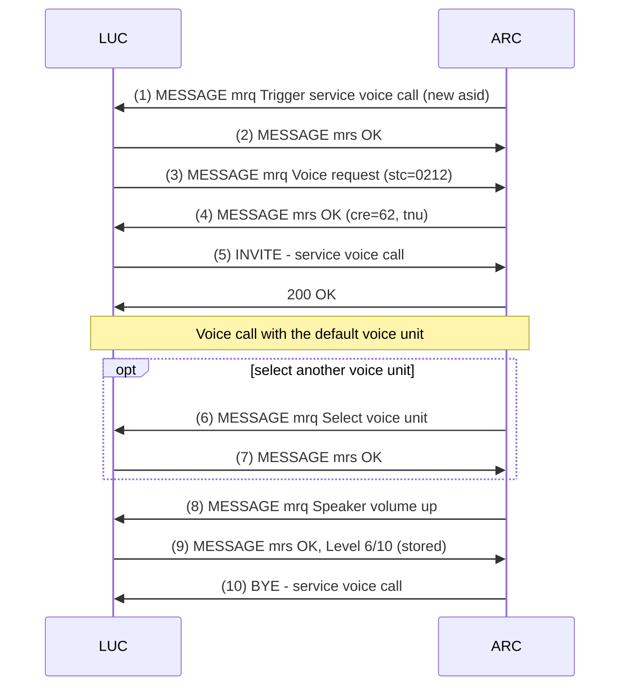

1. The ARC MUST NOT send `aid=0223` while a session of this local unit is running. It MUST create a new `asid` and MUST include `did`. The LUC connects its default voice unit to the call.
2. While an alarm is active at the controller, or while the voice channel needed for the call is busy, the LUC MUST answer `0223` with `snu=12`; no session is opened.
3. After `snu=0` the LUC MUST send a voice request `stc=0212` (service voice call requested by the ARC) with `mreq=1`, the `did` and the `asid` of the command, and call the `tnu` it receives (INVITE with `LACS-ASID` and `did`, see [Addressing](LACS.md#addressing)).
4. If an alarm is initiated at any local unit of the controller during a service voice call, the LUC SHOULD end the service voice call immediately and process the alarm without delay (see [General rules](#general-rules), rule 6).
5. In a service voice call, `0215`, `0216`, `0221` and `0222` change the stored setting of the voice unit (named in `dco` or connected to the call) immediately and permanently. `0217` to `0219` and `0224` apply to the current call only.
6. The LUC MUST limit the adjustable range so that voice communication with trapped persons remains possible; the speaker or microphone MUST NOT be muted by these settings. The range is implementation-defined.
7. The session ends with the end of the call. The LUC MAY end a service voice call after an implementation-defined maximum duration.

#### (1) MESSAGE Request - Trigger service voice call

```xml
MESSAGE sip:14100012345@arc.example.com;transport=tls
...
Content-Type: application/lacs+xml

<mrq>
    <ref>2301</ref>
    <pve>LACS/1.0</pve>
    <mty>CO</mty>
    <aid>0223</aid>
    <cid>14100012345</cid>
    <did>1</did>
    <asid>63a31d0a-48d0-5838-ac2d-0ebb68b08292</asid>
</mrq>
```

#### (2) MESSAGE Response - Trigger service voice call

```xml
MESSAGE sip:reception@arc.example.com;transport=tls
...
Content-Type: application/lacs+xml

<mrs>
    <ref>2301</ref>
    <pve>LACS/1.0</pve>
    <snu>0</snu>
    <asid>63a31d0a-48d0-5838-ac2d-0ebb68b08292</asid>
</mrs>
```

#### (3) MESSAGE Request - Voice request for the service voice call

```xml
MESSAGE sip:reception@arc.example.com;transport=tls
...
Content-Type: application/scaip+xml

<mrq>
    <ref>2302</ref>
    <pve>LACS/1.0</pve>
    <mty>ME</mty>
    <mreq>1</mreq>
    <cid>14100012345</cid>
    <dty>0101</dty>
    <did>1</did>
    <stc>0212</stc>
    <etm>2026-11-04T09:25:42Z</etm>
    <asid>63a31d0a-48d0-5838-ac2d-0ebb68b08292</asid>
</mrq>
```

#### (4) MESSAGE Response - Voice request for the service voice call

```xml
MESSAGE sip:14100012345@arc.example.com;transport=tls
...
Content-Type: application/scaip+xml

<mrs>
    <ref>2302</ref>
    <pve>LACS/1.0</pve>
    <snu>0</snu>
    <mre>1</mre>
    <cre>62</cre>
    <tnu>sips:service@arc.example.com</tnu>
    <asid>63a31d0a-48d0-5838-ac2d-0ebb68b08292</asid>
</mrs>
```

#### (5) INVITE - service voice call

```text
INVITE sips:service@arc.example.com

From: <sip:14100012345@arc.example.com>;did=1
To: <sip:service@arc.example.com>
Contact: <sips:14100012345@192.0.2.10:5061>
LACS-ASID: 63a31d0a-48d0-5838-ac2d-0ebb68b08292
...
```

#### (6) MESSAGE Request - Select voice unit

```xml
MESSAGE sip:14100012345@arc.example.com;transport=tls
...
Content-Type: application/lacs+xml

<mrq>
    <ref>2303</ref>
    <pve>LACS/1.0</pve>
    <mty>CO</mty>
    <aid>0224</aid>
    <cid>14100012345</cid>
    <did>1</did>
    <dco>003</dco>
    <asid>63a31d0a-48d0-5838-ac2d-0ebb68b08292</asid>
</mrq>
```

#### (7) MESSAGE Response - Select voice unit

```xml
MESSAGE sip:reception@arc.example.com;transport=tls
...
Content-Type: application/lacs+xml

<mrs>
    <ref>2303</ref>
    <pve>LACS/1.0</pve>
    <snu>0</snu>
    <asid>63a31d0a-48d0-5838-ac2d-0ebb68b08292</asid>
</mrs>
```

#### (8) MESSAGE Request - Speaker volume up

```xml
MESSAGE sip:14100012345@arc.example.com;transport=tls
...
Content-Type: application/lacs+xml

<mrq>
    <ref>2304</ref>
    <pve>LACS/1.0</pve>
    <mty>CO</mty>
    <aid>0216</aid>
    <cid>14100012345</cid>
    <did>1</did>
    <asid>63a31d0a-48d0-5838-ac2d-0ebb68b08292</asid>
</mrq>
```

#### (9) MESSAGE Response - Speaker volume up, level stored

```xml
MESSAGE sip:reception@arc.example.com;transport=tls
...
Content-Type: application/lacs+xml

<mrs>
    <ref>2304</ref>
    <pve>LACS/1.0</pve>
    <snu>0</snu>
    <ste>Level 6/10</ste>
    <asid>63a31d0a-48d0-5838-ac2d-0ebb68b08292</asid>
</mrs>
```

#### (10) BYE - service voice call

```text
BYE sips:14100012345@192.0.2.10:5061
LACS-ASID: 63a31d0a-48d0-5838-ac2d-0ebb68b08292
...
```

### Text-based Alarm Communication

If the LUC has a TBUI, it MUST inform the ARC via the `cap` property which options the TBUI supports (see [capabilities (cap)](LACS-scaip-xml.md#capabilities-cap)).

> [!IMPORTANT]
>
> If the ARC or the LUC support TBUI, they MUST implement at least the simplest variant with predefined texts (`cap` MUST contain `0011`), which also serves as a fallback level.

**Experimental:** Only the TBUI with predefined texts (`cap` `0011`) is stable. Free text (`cap` `0012` and `0014`, `aid` `0100` and `0101`), dynamic answers (`cap` `0013`) and real-time text (`cap` `0015`) are experimental. Their format can change in a later version, also in a way that is not backward compatible.

As soon as a lift voice alarm in the corresponding local unit is initiated, the LUC MUST ask the user question 1 (and then optionally question 2) immediately, with the answer options Yes and No.

The LUC MUST transfer these automated questions and their answers to the ARC only after they have been answered, including a reference to the template (`aid`). As soon as the ARC has confirmed receipt with `snu=0`, the user will see the message "Help request is being processed..."

The ARC MUST send the command "Help is on the way" (`mty=CO`, `aid=0214`) as soon as it has initiated the rescue; a TBUI shows it as predefined text in the selected language (see [Help is on the way](#help-is-on-the-way) above).

The ARC MUST NOT send free text to the LUC unless the `cap` contains `0012`.

#### Language Support

The TBUI MUST be able to display the predefined text templates in all supported languages, and the user MUST be able to select the appropriate language themselves.

If the user selects a different language, the LUC MUST communicate this language setting to the ARC immediately if the TBUI supports receiving free text (`cap` contains `0012`). This notification is sent with `aid=0109` and `txt` containing the ISO 639-1 language code.

For predefined text templates, `txt` always carries the English text, so that it remains human-readable. For free text communication, the user's last selected language MUST be used.

#### Dynamic Answers

If supported by the TBUI device (`cap` contains `0013`), possible answers from the ARC can also be provided together with the free text (`aid`=`0100`). This occurs within `txt` in the following format:

```text
{question}?{answer-1}/../{answer-n}
```

The ARC MUST provide at least 2 and MUST NOT provide more than 4 answer options.

Sample:

```text
How many people are in the lift?One/Two/Three/Four or more
```

#### Additional Real-time text (RTT)

In addition to the TBUI types defined here, LUC and ARC can optionally support real-time text (RTT) according to RFC 4103 in a separate SRTP channel and additionally provide this to the user.

#### Sequence Diagram

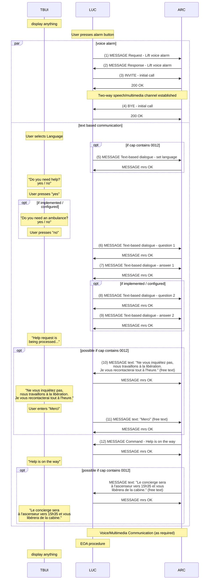

##### (1) MESSAGE Request - Lift voice alarm

```xml
MESSAGE sip:reception@arc.example.com;transport=tls
...
Content-Type: application/scaip+xml

<mrq>
    <ref>2801</ref>
    <pve>LACS/1.0</pve>
    <mty>ME</mty>
    <mreq>1</mreq>
    <cid>14100067890</cid>
    <dty>0101</dty>
    <did>1</did>
    <stc>0010</stc>
    <lco>053</lco>
    <etm>2026-11-04T09:26:22Z</etm>
    <asid>ca10be53-062c-5229-b6fd-4061cef2d9f9</asid>
    <cap>0011,0012,0013,0014,0021</cap>
</mrq>

```

##### (2) MESSAGE Response - Lift voice alarm

```xml
MESSAGE sip:14100067890@arc.example.com;transport=tls
...
Content-Type: application/scaip+xml

<mrs>
    <ref>2801</ref>
    <pve>LACS/1.0</pve>
    <snu>0</snu>
    <mre>1</mre>
    <cre>62</cre>
    <tnu>sips:operator17@arc.example.com</tnu>
    <asid>ca10be53-062c-5229-b6fd-4061cef2d9f9</asid>
</mrs>

```

##### (3) INVITE - initial call

```text
INVITE sips:operator17@arc.example.com

From: <sip:14100067890@arc.example.com>;did=1
To: <sip:operator17@arc.example.com>
Contact: <sips:14100067890@192.0.2.10:5061>
LACS-ASID: ca10be53-062c-5229-b6fd-4061cef2d9f9
...
```

##### (4) BYE - initial call

```text
BYE sips:14100067890@192.0.2.10:5061
LACS-ASID: ca10be53-062c-5229-b6fd-4061cef2d9f9
...
```

##### (5) MESSAGE Text-based dialogue - set language

```xml
MESSAGE sip:reception@arc.example.com;transport=tls
...
Content-Type: application/lacs+xml

<mrq>
    <ref>2802</ref>
    <pve>LACS/1.0</pve>
    <mty>TD</mty>
    <aid>0109</aid>
    <cid>14100067890</cid>
    <did>1</did>
    <dco>031</dco>
    <asid>ca10be53-062c-5229-b6fd-4061cef2d9f9</asid>
    <txt>fr</txt>
</mrq>

```

##### (6) MESSAGE Text-based dialogue - question 1

```xml
MESSAGE sip:reception@arc.example.com;transport=tls
...
Content-Type: application/lacs+xml

<mrq>
    <ref>2803</ref>
    <pve>LACS/1.0</pve>
    <mty>TD</mty>
    <aid>0111</aid>
    <cid>14100067890</cid>
    <did>1</did>
    <dco>031</dco>
    <asid>ca10be53-062c-5229-b6fd-4061cef2d9f9</asid>
    <txt>Do you need help?</txt>
</mrq>

```

##### (7) MESSAGE Text-based dialogue - answer 1

```xml
MESSAGE sip:reception@arc.example.com;transport=tls
...
Content-Type: application/lacs+xml

<mrq>
    <ref>2804</ref>
    <pve>LACS/1.0</pve>
    <mty>TD</mty>
    <aid>0121</aid>
    <cid>14100067890</cid>
    <did>1</did>
    <dco>031</dco>
    <asid>ca10be53-062c-5229-b6fd-4061cef2d9f9</asid>
    <txt>Yes</txt>
</mrq>

```

##### (8) MESSAGE Text-based dialogue - question 2

```xml
MESSAGE sip:reception@arc.example.com;transport=tls
...
Content-Type: application/lacs+xml

<mrq>
    <ref>2805</ref>
    <pve>LACS/1.0</pve>
    <mty>TD</mty>
    <aid>0112</aid>
    <cid>14100067890</cid>
    <did>1</did>
    <dco>031</dco>
    <asid>ca10be53-062c-5229-b6fd-4061cef2d9f9</asid>
    <txt>Do you need an ambulance?</txt>
</mrq>

```

##### (9) MESSAGE Text-based dialogue - answer 2

```xml
MESSAGE sip:reception@arc.example.com;transport=tls
...
Content-Type: application/lacs+xml

<mrq>
    <ref>2806</ref>
    <pve>LACS/1.0</pve>
    <mty>TD</mty>
    <aid>0122</aid>
    <cid>14100067890</cid>
    <did>1</did>
    <dco>031</dco>
    <asid>ca10be53-062c-5229-b6fd-4061cef2d9f9</asid>
    <txt>No</txt>
</mrq>

```

##### (10) MESSAGE Text-based dialogue - free text

```xml
MESSAGE sip:14100067890@arc.example.com;transport=tls
...
Content-Type: application/lacs+xml

<mrq>
    <ref>2807</ref>
    <pve>LACS/1.0</pve>
    <mty>TD</mty>
    <aid>0100</aid>
    <cid>14100067890</cid>
    <did>1</did>
    <dco>031</dco>
    <asid>ca10be53-062c-5229-b6fd-4061cef2d9f9</asid>
    <txt>Ne vous inquiétez pas, nous travaillons à la libération. Je vous recontacterai tout à l'heure.</txt>
</mrq>

```

##### (11) MESSAGE Text-based dialogue - free text

```xml
MESSAGE sip:reception@arc.example.com;transport=tls
...
Content-Type: application/lacs+xml

<mrq>
    <ref>2808</ref>
    <pve>LACS/1.0</pve>
    <mty>TD</mty>
    <aid>0100</aid>
    <cid>14100067890</cid>
    <did>1</did>
    <dco>031</dco>
    <asid>ca10be53-062c-5229-b6fd-4061cef2d9f9</asid>
    <txt>Merci</txt>
</mrq>

```

##### (12) MESSAGE Command - Help is on the way

```xml
MESSAGE sip:14100067890@arc.example.com;transport=tls
...
Content-Type: application/lacs+xml

<mrq>
    <ref>2809</ref>
    <pve>LACS/1.0</pve>
    <mty>CO</mty>
    <aid>0214</aid>
    <cid>14100067890</cid>
    <did>1</did>
    <asid>ca10be53-062c-5229-b6fd-4061cef2d9f9</asid>
</mrq>

```

### Camera support

The LUC announces its camera functions by `cap` `0021` to `0023` (see [capabilities (cap)](LACS-scaip-xml.md#capabilities-cap)):

- `0021`: the still image is sent as JPEG in a multipart response to the command `aid=0200` (see [Single Snapshot](#single-snapshot)).
- `0022`: the video stream is offered in the INVITE as an additional SRTP stream (SDP), with muted audio.
- `0023`: video and audio are offered as two SRTP streams; they can be switched during the session with a re-INVITE.

#### Single Snapshot

> [!IMPORTANT]
>
> **JPEG Size Limitation**
>
> The JPEG image included in the multipart response MUST NOT exceed 1 MiB (1 048 576 bytes) in its binary form.
> Due to Base64 expansion (4/3), the maximum size of the Base64-encoded JPEG payload is 1 398 104 bytes, not counting line breaks.
> The Base64 encoding follows RFC 2045 §6.8: lines of at most 76 characters, separated by CRLF.
> The LUC MUST ensure that the Base64-encoded block does not exceed this limit.

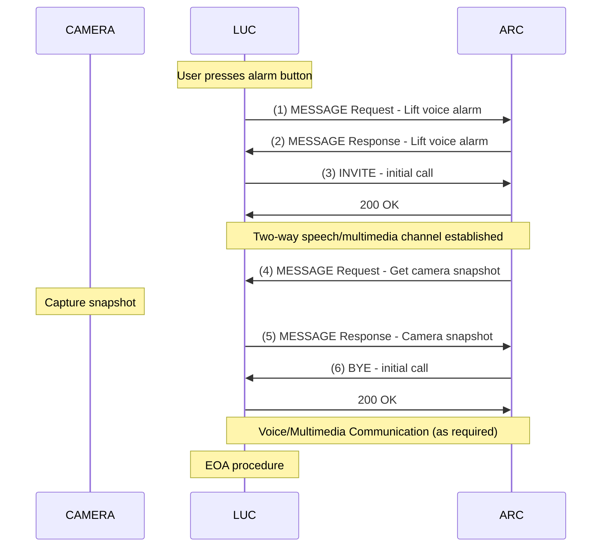

##### (1) MESSAGE Request - Lift voice alarm

```xml
MESSAGE sip:reception@arc.example.com;transport=tls
...
Content-Type: application/scaip+xml

<mrq>
    <ref>3001</ref>
    <pve>LACS/1.0</pve>
    <mty>ME</mty>
    <mreq>1</mreq>
    <cid>14100067890</cid>
    <dty>0101</dty>
    <did>1</did>
    <stc>0010</stc>
    <lco>053</lco>
    <etm>2026-11-04T09:27:02Z</etm>
    <asid>d160505a-fa44-5276-846d-a6e6ff6ec18d</asid>
    <cap>0011,0012,0013,0014,0021</cap>
</mrq>

```

##### (2) MESSAGE Response - Lift voice alarm

```xml
MESSAGE sip:14100067890@arc.example.com;transport=tls
...
Content-Type: application/scaip+xml

<mrs>
    <ref>3001</ref>
    <pve>LACS/1.0</pve>
    <snu>0</snu>
    <mre>1</mre>
    <cre>62</cre>
    <tnu>sips:operator17@arc.example.com</tnu>
    <asid>d160505a-fa44-5276-846d-a6e6ff6ec18d</asid>
</mrs>

```

##### (3) INVITE - initial call

```text
INVITE sips:operator17@arc.example.com

From: <sip:14100067890@arc.example.com>;did=1
To: <sip:operator17@arc.example.com>
Contact: <sips:14100067890@192.0.2.10:5061>
LACS-ASID: d160505a-fa44-5276-846d-a6e6ff6ec18d
...
```

##### (4) MESSAGE Request - Get camera snapshot

```xml
MESSAGE sip:14100067890@arc.example.com;transport=tls
...
Content-Type: application/lacs+xml

<mrq>
    <ref>3010</ref>
    <pve>LACS/1.0</pve>
    <mty>CO</mty>
    <aid>0200</aid>
    <cid>14100067890</cid>
    <did>1</did>
    <asid>d160505a-fa44-5276-846d-a6e6ff6ec18d</asid>
</mrq>
```

##### (5) MESSAGE Response - Camera snapshot

```xml
MESSAGE sip:reception@arc.example.com;transport=tls
...
Content-Type: multipart/mixed; boundary="lacs-boundary-001"
Content-Length: 950000

--lacs-boundary-001
Content-Type: application/lacs+xml; charset=utf-8
Content-Transfer-Encoding: 8bit

<mrs>
    <ref>3010</ref>
    <pve>LACS/1.0</pve>
    <snu>0</snu>
    <asid>d160505a-fa44-5276-846d-a6e6ff6ec18d</asid>
</mrs>

--lacs-boundary-001
Content-Type: image/jpeg
Content-Transfer-Encoding: base64

{base64-encoded-JPEG}

--lacs-boundary-001--
```

##### (6) BYE - initial call

```text
BYE sips:14100067890@192.0.2.10:5061
LACS-ASID: d160505a-fa44-5276-846d-a6e6ff6ec18d
...
```
