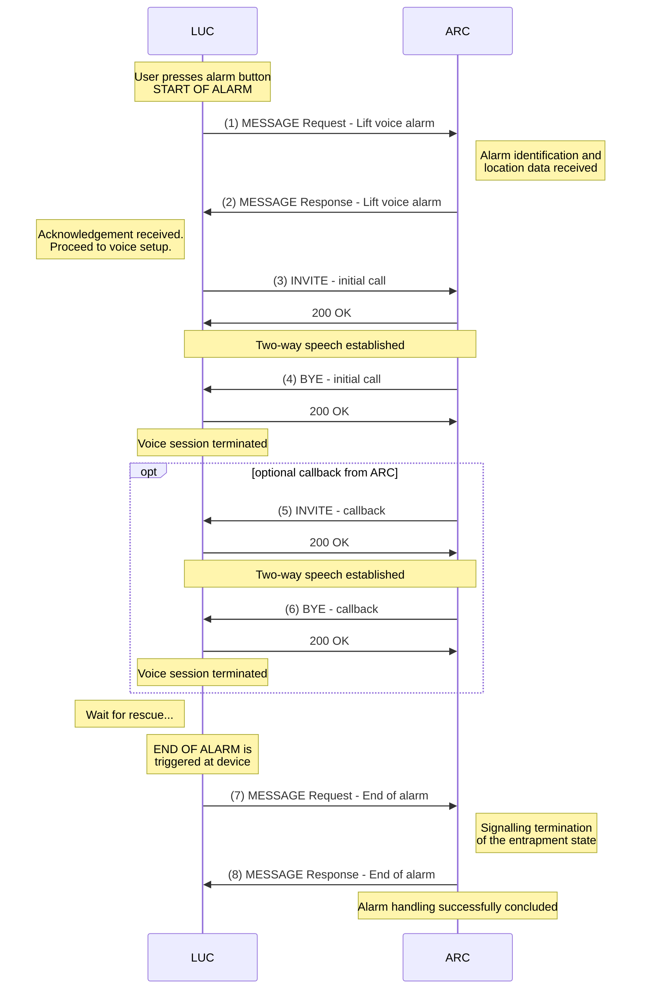
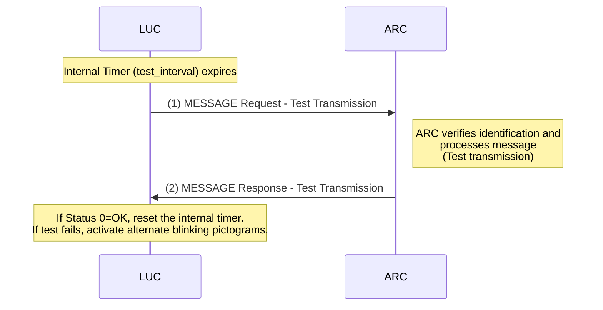
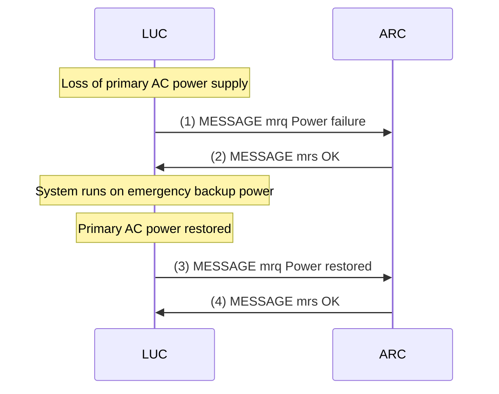
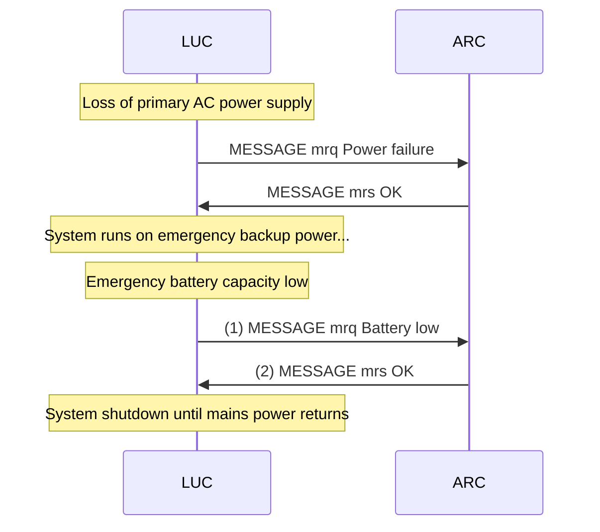
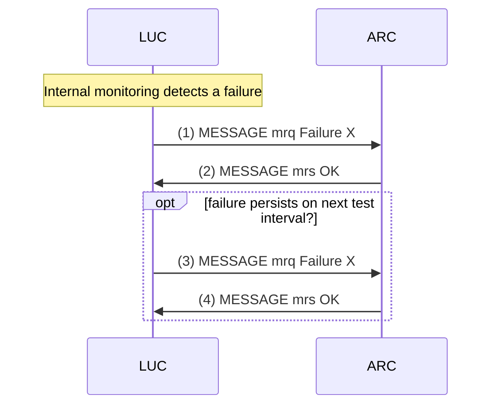
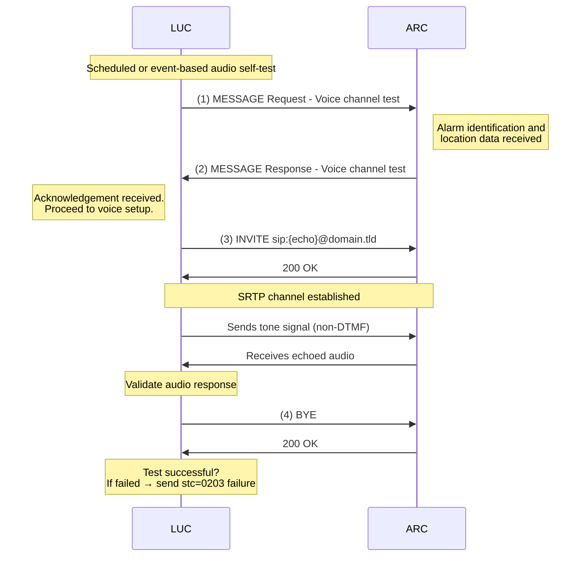
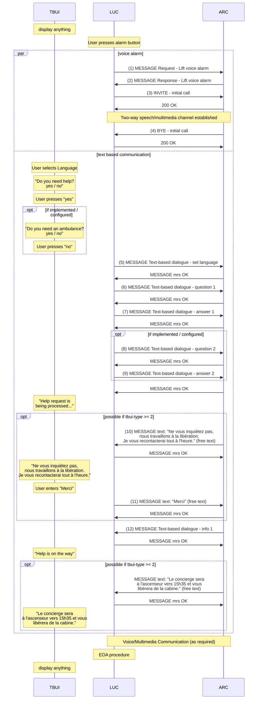
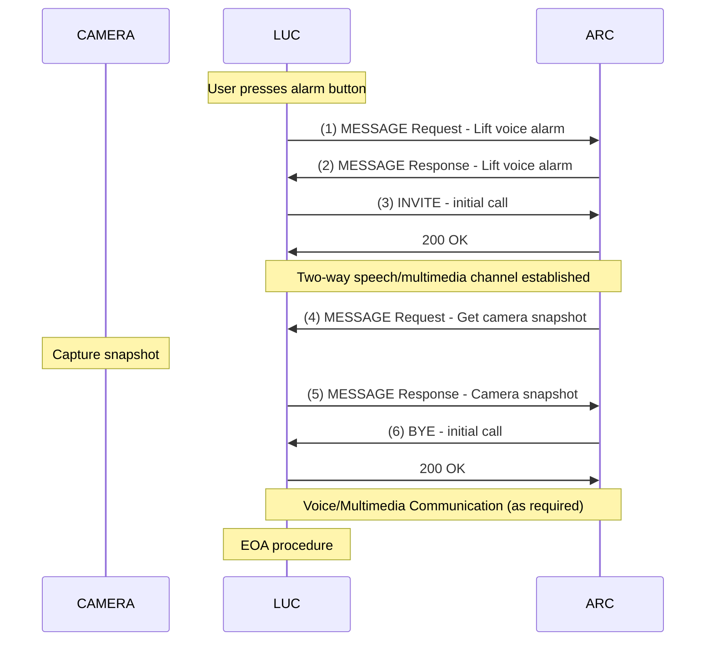

# LACS — Use Cases and Sequence Diagrams

**Part of:** [Lift Alarm Communication Standard (LACS)](LACS.md) v0.08-draft

> [!WARNING]
>
> All sequence diagrams below are rough drafts and may still contain serious errors.

For message property definitions, see:
- [LACS-scaip-xml.md](LACS-scaip-xml.md) — `application/scaip+xml` message properties
- [LACS-lacs-xml.md](LACS-lacs-xml.md) — `application/lacs+xml` message properties

---

## scaip+xml Use Cases

The following use cases use `Content-Type: application/scaip+xml` for signalling.

### Lift Voice Alarm



#### (1) MESSAGE Request - Lift voice alarm

```xml
MESSAGE sip:{arc-reception}@domain.tld;transport=tls
...
Content-Type: application/scaip+xml

<mrq>
    <ref>{ref-1}</ref>
    <mty>ME</mty>
    <mreq>1</mreq>
    <cid>{controller-id}</cid>
    <dty>0101</dty>
    <did>{device-id}</did>
    <stc>0010</stc>
    <lco>053</lco>
    <asid>{alert-session-id}</asid>
</mrq>
```

#### (2) MESSAGE Response - Lift voice alarm

```xml
MESSAGE sip:{controller-id}@domain.tld;transport=tls
...
Content-Type: application/scaip+xml

<mrs>
	<ref>{ref-1}</ref>
    <snu>0</snu>
    <mre>1</mre>
    <cre>62</cre>
    <tnu>sips:{arc-operator}@domain.tld</tnu>
    <asid>{alert-session-id}</asid>
</mrs>
```

#### (3) INVITE - initial call

```
INVITE sip:{arc-operator}@domain.tld;transport=tls

From: <sip:{controller-id}@domain.tld>;did={device-id}
To: <sip:{arc-operator}@domain.tld>
Contact: <sip:{controller-id}@{ip}:{port};transport=tls;asid={alert-session-id}>
...
```

#### (4) BYE - initial call

```
BYE sip:{controller-id}@{ip}:{port};transport=tls;asid={alert-session-id}
...
```

#### (5) INVITE - callback

```
INVITE sip:{controller-id}@domain.tld;transport=tls;did={device-id}

From: <sip:{arc-operator}@domain.tld>;did={device-id}
To: <sip:{controller-id}@domain.tld>
Contact: <sip:{arc-operator}@{ip}:{port};transport=tls;asid={alert-session-id}>
...
```

#### (6) BYE - callback

```
BYE sip:{controller-id}@{ip}:{port};transport=tls;asid={alert-session-id}
...
```

#### (7) MESSAGE Request - End of alarm

```xml
MESSAGE sip:{arc-reception}@domain.tld;transport=tls
...
Content-Type: application/scaip+xml

<mrq>
    <ref>{ref-2}</ref>
    <mty>ME</mty>
    <cid>{controller-id}</cid>
    <dty>0101</dty>
    <did>{device-id}</did>
    <stc>0201</stc>
    <lco>053</lco>
    <asid>{alert-session-id}</asid>
</mrq>
```

#### (8) MESSAGE Response - End of alarm

```xml
MESSAGE sip:{controller-id}@domain.tld;transport=tls
...
Content-Type: application/scaip+xml

<mrs>
	<ref>{ref-2}</ref>
    <snu>0</snu>
    <asid>{alert-session-id}</asid>
</mrs>
```

### Test Transmission



#### (1) MESSAGE Request - Test Transmission

```xml
MESSAGE sip:{arc-reception}@domain.tld;transport=tls
...
Content-Type: application/scaip+xml

<mrq>
    <ref>{ref-1}</ref>
    <mty>ME</mty>
    <cid>{controller-id}</cid>
    <dty>0101</dty>
    <did>{device-id}</did>
    <stc>0102</stc>
    <lco>053</lco>
    <asid>{alert-session-id}</asid>
</mrq>
```

#### (2) MESSAGE Response - Test Transmission

```xml
MESSAGE sip:{controller-id}@domain.tld;transport=tls
...
Content-Type: application/scaip+xml

<mrs>
	<ref>{ref-1}</ref>
    <snu>0</snu>
    <asid>{alert-session-id}</asid>
</mrs>
```

### Power Outage

#### Short Power Outage

A short outage results in a **failure and a restoration message**.



##### (1) MESSAGE mrq — Power failure

```xml
MESSAGE sip:{arc-reception}@domain.tld;transport=tls
...
Content-Type: application/scaip+xml

<mrq>
    <ref>{ref-1}</ref>
    <mty>ME</mty>
    <cid>{controller-id}</cid>
    <dty>0045</dty>
    <stc>0085</stc>
    <asid>{alert-session-id-1}</asid>
</mrq>
```

##### (2) MESSAGE mrs — Power failure OK

```xml
MESSAGE sip:{controller-id}@domain.tld;transport=tls
...
Content-Type: application/scaip+xml

<mrs>
    <ref>{ref-1}</ref>
    <snu>0</snu>
    <asid>{alert-session-id-1}</asid>
</mrs>
```

##### (3) MESSAGE mrq — Power restored

```xml
MESSAGE sip:{arc-reception}@domain.tld;transport=tls
...
Content-Type: application/scaip+xml

<mrq>
    <ref>{ref-2}</ref>
    <mty>ME</mty>
    <cid>{controller-id}</cid>
    <dty>0045</dty>
    <stc>0086</stc>
    <asid>{alert-session-id-2}</asid>
</mrq>
```

##### (4) MESSAGE mrs — Power restored OK

```xml
MESSAGE sip:{controller-id}@domain.tld;transport=tls
...
Content-Type: application/scaip+xml

<mrs>
    <ref>{ref-2}</ref>
    <snu>0</snu>
    <asid>{alert-session-id-2}</asid>
</mrs>
```

#### Long Power Outage

If the mains is not restored, the emergency power supply may become critically low.
In this case **no "power restored" message is sent**, and a **battery low** status must be transmitted before shutdown.



##### (1) MESSAGE mrq — Battery low

```xml
MESSAGE sip:{arc-reception}@domain.tld;transport=tls
...
Content-Type: application/scaip+xml

<mrq>
    <ref>{ref-3}</ref>
    <mty>ME</mty>
    <cid>{controller-id}</cid>
    <dty>0045</dty>
    <stc>0016</stc>
    <asid>{alert-session-id-2}</asid>
</mrq>
```

##### (2) MESSAGE mrs — Battery low ACK

```xml
MESSAGE sip:{controller-id}@domain.tld;transport=tls
...
Content-Type: application/scaip+xml

<mrs>
    <ref>{ref-3}</ref>
    <snu>0</snu>
    <asid>{alert-session-id-2}</asid>
</mrs>
```

### Function monitoring and failure notification

LUC should check at least on every `test_interval`:

| To be checked                                                                                                  | Comment                                                                                            | mrq on failure                                                      |
| -------------------------------------------------------------------------------------------------------------- | -------------------------------------------------------------------------------------------------- | ------------------------------------------------------------------- |
| Condition emergency supply for local unit(s) and controller is good and it fulfils the requirements of EN81-28 | Mandatory according to EN81-28                                                                     | Battery failure<br />`stc` = 0014                                   |
| Voice channel (RTP) towards ARC works properly                                                                 | Must be checked using voice channel test sequence (see section below)                              | Voice channel (RTP) failure<br />`stc` = 0203                       |
| Pressing and releasing the alarm button at local unit works properly                                           | Optional - Only possible with special hardware such as a remotely operated button                  | Alarm button failure<br />`dco` = 002 / 003 / 004<br />`stc` = 0204 |
| Proper functionality of microphone and loudspeaker at local unit                                               | Optional - Audio signal played through speaker must be received by microphone at appropriate level | Microphone speaker failure<br />`dco` = 090<br />`stc` = 0205       |
| Communication link of internal bus between Local Unit(s) and Controller is available                           | Optional                                                                                           | Internal Bus failure<br />`dty` = 0032<br />`stc` = 0206            |

If a failure is detected:

1. The LUC must immediately transmit a `mrq` `MESSAGE` with the appropriate properties.
2. If the failure still persists on next check a new message must be send with the same failure. The interval at which the LUC performs function checks must not exceed the configured `test_interval`.

#### Generic Sequence diagram



---

#### Example: Battery Failure (0014)

##### (1) MESSAGE mrq - Battery failure

```xml
MESSAGE sip:{arc-reception}@domain.tld;transport=tls
...
Content-Type: application/scaip+xml

<mrq>
    <ref>{ref-1}</ref>
    <mty>ME</mty>
    <cid>{controller-id}</cid>
    <dty>0045</dty>
    <stc>0014</stc>
    <asid>{alert-session-id-1}</asid>
</mrq>
```

##### (2) MESSAGE mrs OK

```xml
MESSAGE sip:{controller-id}@domain.tld;transport=tls
...
Content-Type: application/scaip+xml

<mrs>
    <ref>{ref-1}</ref>
    <snu>0</snu>
    <asid>{alert-session-id-1}</asid>
</mrs>
```

The failure persists on next test interval.

##### (3) MESSAGE mrq - Battery failure

```xml
MESSAGE sip:{arc-reception}@domain.tld;transport=tls
...
Content-Type: application/scaip+xml

<mrq>
    <ref>{ref-2}</ref>
    <mty>ME</mty>
    <cid>{controller-id}</cid>
    <dty>0045</dty>
    <stc>0014</stc>
    <asid>{alert-session-id-2}</asid>
</mrq>
```

##### (4) MESSAGE mrs OK

```xml
MESSAGE sip:{controller-id}@domain.tld;transport=tls
...
Content-Type: application/scaip+xml

<mrs>
    <ref>{ref-2}</ref>
    <snu>0</snu>
    <asid>{alert-session-id-2}</asid>
</mrs>
```

#### SIP Voice Channel Test Sequence



##### (1) MESSAGE Request - Voice channel test

```xml
MESSAGE sip:{arc-reception}@domain.tld;transport=tls
...
Content-Type: application/scaip+xml

<mrq>
    <ref>{ref-1}</ref>
    <mty>ME</mty>
    <cid>{controller-id}</cid>
    <stc>0202</stc>
    <asid>{alert-session-id}</asid>
</mrq>
```

##### (2) MESSAGE Response - Voice channel test

```xml
MESSAGE sip:{controller-id}@domain.tld;transport=tls
...
Content-Type: application/scaip+xml

<mrs>
	<ref>{ref-1}</ref>
    <snu>0</snu>
    <cre>62</cre>
    <tnu>sips:{echo}@domain.tld</tnu>
    <asid>{alert-session-id}</asid>
</mrs>
```

##### (3) INVITE Request — Echo Test

```
INVITE sip:{echo}@domain.tld;transport=tls SIP/2.0
From: <sip:{controller-id}@domain.tld>;did={device-id}
To: <sip:{echo}@domain.tld>
Contact: <sip:{controller-id}@{ip}:{port};transport=tls;asid={alert-session-id}>
...
```

##### (4) BYE Request — Echo Test Termination

```
BYE sip:{echo}@domain.tld;transport=tls;asid={alert-session-id} SIP/2.0
Via: SIP/2.0/TLS {ip}:{port};branch=z9hG4bK-bye222
From: <sip:{controller-id}@domain.tld>;did={device-id};tag=abc123
To: <sip:{echo}@domain.tld>;tag=arc987
...
```

---

## lacs+xml Use Cases

The following use cases use `Content-Type: application/lacs+xml` for the extended communication. They always occur within the context of an active alarm session that was initiated via `scaip+xml`.

### Text-based Alarm Communication

If the LUC has an integrated TBUI, it must inform the ARC via the `cap` property in the lift voice alarm which options the TBUI supports.

> [!IMPORTANT]
>
> If the ARC or the LUC support TBUI, they must have implemented at least the simplest variant with predefined texts (`cap` must contain `0011`), which also serves as a fallback level.

As soon as a lift voice alarm in the corresponding local unit is initiated, the user must be asked question 1 (and then optionally question 2) immediately, with the answer options Yes and No.

These automated questions and their answers may only be transferred to the ARC after they have been answered, including a reference to the template (`aid`). As soon as the ARC has confirmed receipt with 200 OK, the user will see the message "Help request is being processed..."

If the TBUI has been operated and a rescue is initiated, a 'Help is on the way' with `aid=0131` must be sent from the ARC to the LUC.

The ARC is only allowed to send free text to the LUC if the `cap` contains `0012`.

#### Language Support

The TBUI must be able to display the predefined text templates in all supported languages, and the user must be able to select the appropriate language themselves.

If the user selects a different language, this language setting must be communicated to the ARC immediately if the TBUI supports receiving free text (`cap` contains `0012`). This notification is sent with `aid=0109` and `txt` containing the ISO 639-1 language code

The text property for messages is always additionally transmitted in English for predefined text templates (in order to remain human-readable). For free text communication, the user's last selected language must always be used.

#### Dynamic Answers

If supported by the TBUI device (`cap` contains `0013`), possible answers from the ARC can also be provided together with the free text (`aid`=`0100`). This occurs within the `text` property in the following format:

```
<Question>?<Answer 1>/../<Answer n>
```

At least 2 answer options must be provided and there must not be more than 4 answer options.

Sample:

```
How many people are in the lift?One/Two/Three/Four or more
```

#### Additional Real-time text (RTT)

In addition to the TBUI types defined here, LUC and ARC can optionally support real-time text (RTT) according to RFC 4103 in a separate SRTP channel and additionally provide this to the user.

#### Sequence Diagram



##### (1) MESSAGE Request - Lift voice alarm

```xml
MESSAGE sip:{arc-reception}@domain.tld;transport=tls
...
Content-Type: application/scaip+xml

<mrq>
    <ref>{ref-1}</ref>
    <mty>ME</mty>
    <mreq>1</mreq>
    <cid>{controller-id}</cid>
    <dty>0101</dty>
    <did>{device-id}</did>
    <stc>0010</stc>
    <lco>053</lco>
    <asid>{alert-session-id}</asid>
    <cap>0011,0012,0013,0014</cap>
</mrq>

```

##### (2) MESSAGE Response - Lift voice alarm

```xml
MESSAGE sip:{controller-id}@domain.tld;transport=tls
...
Content-Type: application/scaip+xml

<mrs>
	<ref>{ref-1}</ref>
    <snu>0</snu>
    <mre>1</mre>
    <cre>62</cre>
    <tnu>sips:{arc-operator}@domain.tld</tnu>
    <asid>{alert-session-id}</asid>
</mrs>

```

##### (3) INVITE - initial call

```
INVITE sip:{arc-operator}@domain.tld;transport=tls

From: <sip:{controller-id}@domain.tld>;did={device-id}
To: <sip:{arc-operator}@domain.tld>
Contact: <sip:{controller-id}@{ip}:{port};transport=tls;asid={alert-session-id}>
...
```

##### (4) BYE - initial call

```
BYE sip:{controller-id}@{ip}:{port};transport=tls;asid={alert-session-id}
...
```

##### (5) MESSAGE Text-based dialogue - set language

```xml
MESSAGE sip:{arc-reception}@domain.tld;transport=tls
...
Content-Type: application/lacs+xml

<mrq>
    <ref>{ref-2}</ref>
    <mty>TD</mty>
    <aid>0109</aid>
    <cid>{controller-id}</cid>
    <did>{device-id}</did>
    <dco>92</dco>
    <asid>{alert-session-id}</asid>
    <txt>fr</txt>
</mrq>

```

##### (6) MESSAGE Text-based dialogue - question 1

```xml
MESSAGE sip:{arc-reception}@domain.tld;transport=tls
...
Content-Type: application/lacs+xml

<mrq>
    <ref>{ref-3}</ref>
    <mty>TD</mty>
    <aid>0111</aid>
    <cid>{controller-id}</cid>
    <did>{device-id}</did>
    <dco>92</dco>
    <asid>{alert-session-id}</asid>
    <txt>Do you need help?</txt>
</mrq>

```

##### (7) MESSAGE Text-based dialogue - answer 1

```xml
MESSAGE sip:{arc-reception}@domain.tld;transport=tls
...
Content-Type: application/lacs+xml

<mrq>
    <ref>{ref-4}</ref>
    <mty>TD</mty>
    <aid>0121</aid>
    <cid>{controller-id}</cid>
    <did>{device-id}</did>
    <dco>92</dco>
    <asid>{alert-session-id}</asid>
    <txt>Yes</txt>
</mrq>

```

##### (8) MESSAGE Text-based dialogue - question 2

```xml
MESSAGE sip:{arc-reception}@domain.tld;transport=tls
...
Content-Type: application/lacs+xml

<mrq>
    <ref>{ref-5}</ref>
    <mty>TD</mty>
    <aid>0112</aid>
    <cid>{controller-id}</cid>
    <did>{device-id}</did>
    <dco>92</dco>
    <asid>{alert-session-id}</asid>
    <txt>Do you need an ambulance?</txt>
</mrq>

```

##### (9) MESSAGE Text-based dialogue - answer 2

```xml
MESSAGE sip:{arc-reception}@domain.tld;transport=tls
...
Content-Type: application/lacs+xml

<mrq>
    <ref>{ref-6}</ref>
    <mty>TD</mty>
    <aid>0122</aid>
    <cid>{controller-id}</cid>
    <did>{device-id}</did>
    <dco>92</dco>
    <asid>{alert-session-id}</asid>
    <txt>No</txt>
</mrq>

```

##### (10) MESSAGE Text-based dialogue - free text

```xml
MESSAGE sip:{controller-id}@domain.tld;transport=tls
...
Content-Type: application/lacs+xml

<mrq>
    <ref>{ref-7}</ref>
    <mty>TD</mty>
    <aid>0100</aid>
    <cid>{controller-id}</cid>
    <did>{device-id}</did>
    <dco>92</dco>
    <asid>{alert-session-id}</asid>
    <txt>Ne vous inquiétez pas, nous travaillons à la libération. Je vous recontacterai tout à l'heure.</txt>
</mrq>

```

##### (11) MESSAGE Text-based dialogue - free text

```xml
MESSAGE sip:{arc-reception}@domain.tld;transport=tls
...
Content-Type: application/lacs+xml

<mrq>
    <ref>{ref-8}</ref>
    <mty>TD</mty>
    <aid>0100</aid>
    <cid>{controller-id}</cid>
    <did>{device-id}</did>
    <dco>92</dco>
    <asid>{alert-session-id}</asid>
    <txt>Merci</txt>
</mrq>

```

##### (12) MESSAGE Text-based dialogue - info 1

```xml
MESSAGE sip:{controller-id}@domain.tld;transport=tls
...
Content-Type: application/lacs+xml

<mrq>
    <ref>{ref-9}</ref>
    <mty>TD</mty>
    <aid>0131</aid>
    <cid>{controller-id}</cid>
    <did>{device-id}</did>
    <dco>92</dco>
    <asid>{alert-session-id}</asid>
    <txt>Help is on the way</txt>
</mrq>

```

### Camera support

Variants of camera support:

| cap value | Description                                       | Implementation                                                                                     |
| --------- | ------------------------------------------------- | -------------------------------------------------------------------------------------------------- |
| 0021      | CAMERA with still image (single snapshot)         | JPEG image as multipart SIP response see below                                                     |
| 0022      | CAMERA with video stream LUC -> ARC               | SDP + INVITE + SRTP - one stream with muted audio                                                  |
| 0023      | CAMERA with bidirectional video stream with audio | SDP + INVITE + SRTP - two streams with audio - <br /> can be switched during session with REINVITE |

#### Single Snapshot

> [!IMPORTANT]
>
> **JPEG Size Limitation**
>
> The JPEG image included in the multipart response must not exceed 1 MiB (1 048 576 bytes) in its binary form.
> Due to Base64 expansion (4/3), the maximum size of the Base64-encoded JPEG payload is 1 398 102 bytes.
> The LUC must ensure that the Base64-encoded block does not exceed this limit.



##### (1) MESSAGE Request - Lift voice alarm

```xml
MESSAGE sip:{arc-reception}@domain.tld;transport=tls
...
Content-Type: application/scaip+xml

<mrq>
    <ref>{ref-1}</ref>
    <mty>ME</mty>
    <mreq>1</mreq>
    <cid>{controller-id}</cid>
    <dty>0101</dty>
    <did>{device-id}</did>
    <stc>0010</stc>
    <lco>053</lco>
    <asid>{alert-session-id}</asid>
    <cap>0021</cap>
</mrq>

```

##### (2) MESSAGE Response - Lift voice alarm

```xml
MESSAGE sip:{controller-id}@domain.tld;transport=tls
...
Content-Type: application/scaip+xml

<mrs>
	<ref>{ref-1}</ref>
    <snu>0</snu>
    <mre>1</mre>
    <cre>62</cre>
    <tnu>sips:{arc-operator}@domain.tld</tnu>
    <asid>{alert-session-id}</asid>
</mrs>

```

##### (3) INVITE - initial call

```
INVITE sip:{arc-operator}@domain.tld;transport=tls

From: <sip:{controller-id}@domain.tld>;did={device-id}
To: <sip:{arc-operator}@domain.tld>
Contact: <sip:{controller-id}@{ip}:{port};transport=tls;asid={alert-session-id}>
...
```

##### (4) MESSAGE Request - Get camera snapshot

```xml
MESSAGE sip:{controller-id}@domain.tld; transport=tls; did={device-id}

...
Content-Type: application/lacs+xml

<mrq>
    <ref>{ref}</ref>
    <mty>CO</mty>
    <aid>0200</aid>
    <cid>{controller-id}</cid>
    <did>{device-id}</did>
    <asid>{alert-session-id}</asid>
</mrq>
```

##### (5) MESSAGE Response - Camera snapshot

```xml
MESSAGE sip:{arc-reception}@domain.tld; transport=tls

...
Content-Type: multipart/mixed; boundary="lacs-boundary-001"
Content-Length: 950000

--lacs-boundary-001
Content-Type: application/lacs+xml; charset=utf-8
Content-Transfer-Encoding: 8bit

<mrs>
	<ref>{ref}</ref>
	<snu>0</snu>
</mrs>

--lacs-boundary-001
Content-Type: image/jpeg
Content-Transfer-Encoding: base64

{base64-encoded-JPEG}

--lacs-boundary-001--
```

##### (6) BYE - initial call

```
BYE sip:{controller-id}@{ip}:{port};transport=tls;asid={alert-session-id}
...
```
