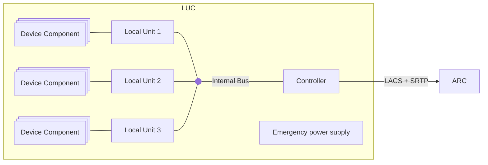

# Lift Alarm Communication Standard (LACS)

**Version:** 0.12-draft

**Last Updated:** 2026-05-13

**Maintainer:** Telegärtner Elektronik GmbH

**Canonical Source Repository:**
https://codeberg.org/telegaertner-elektronik/LACS-Protocol

**Contributors:**

- IOT Communications International AB
- Serv24 GmbH

## Disclaimer - Early Draft

> [!WARNING]
>
> This document represents an early, incomplete draft of the **Lift Alarm Communication Standard (LACS)**.
> Fundamental technical details **may change significantly** as the standard evolves.
> Implementations based solely on this version should therefore be considered **experimental and not production-ready**.

## Licence

This documentation is published under the **Creative Commons Attribution-ShareAlike (CC BY-SA)** licence.
You are free to use, copy, distribute, and modify this work, provided that proper attribution is given and that any derived works are released under the same licence.

We explicitly encourage **open collaboration and feedback**. If you identify inconsistencies, security concerns, or technical improvements, or if you would like to propose extensions to the current specification, please share your suggestions openly.
The aim of LACS is to evolve transparently and to serve as an open, widely applicable communication standard for lift alarm systems.

### Additional Permissions for Standardisation Bodies

In addition to the rights granted under the Creative Commons Attribution-ShareAlike 4.0 International licence (CC BY-SA 4.0), the authors grant CEN, CENELEC, ETSI and other recognised standardisation bodies a non-exclusive, irrevocable permission to reproduce, adapt, incorporate and publish this specification or parts of it in any formal standard, without the obligation to apply the Share-Alike requirement of CC BY-SA to the resulting standard or its derivatives.

This permission applies exclusively to the creation of formal standards and does not limit the CC BY-SA licensing that applies to all other users.

## Purpose

The purpose of this document is to standardise the practical implementation of lift alarm in accordance with EN 81-28:2022 on the basis of CLC/TS 50134-9:2018. The Information Note "Voice over IP for EN 81-28 communication system" issued by the ELA TELCO WG in January 2024 is taken into account.

It also takes into account optional practical applications that go beyond the basic requirements of EN 81-28.

The supplementary specifications in this document are intended to achieve a protocol that can be implemented as universally as possible and supported by as many manufacturers and alarm receiving centres as possible.

The document also contains specific examples to facilitate implementation and avoid misunderstandings.

### Motivation

The motivation for creating this specification arises from several gaps and insufficiently specified behaviours found in the ELA Information Note and in CLC/TS 50134-9:

- Missing precise definitions regarding specific processes, message properties, and when particular codes should/may/must be used.
  Without such clarification, independent implementations would differ in critical aspects, resulting in derivatives or dialects instead of a universally applicable standard.
- Lack of a clearly defined call sequence that ensures conformity with both normative and application-specific requirements for lift alarms
- No consistent session association for all messages exchanged from the initial alarm trigger to the end of the alarm
- Insufficient coverage of relevant message types already essential in state of the art lift alarm systems, including:
  - Alarm button failure
  - Microphone/speaker failure
  - Internal bus failure
  - Communication voice failure
- No mechanism for validating bidirectional communication in the voice channel, which was previously ensured implicitly by DTMF-based protocols
- No provision for extended, asynchronous communication between LUC and ARC, necessary for features commonly implemented in modern lift alarm systems such as:
  - Text-based alarm communication
  - Camera integration and image retrieval
- No method for the LUC to announce its supported extended capabilities to the ARC (e.g., TBUI features, camera functions, ...)

## Normative References

The following normative documents contain provisions which, through reference in this text, constitute provisions of this specification. For dated references, only the edition cited applies. For undated references, the latest edition of the referenced document (including any amendments) applies.

- **EN 81-28:2022** – Safety rules for the construction and installation of lifts – Part 28: Remote alarm on passenger and goods passenger lifts
- **CLC/TS 50134-9:2018** – Alarm systems – Social alarm systems – Part 9: Internet Protocol (IP) based transmission using SCAIP (Social Care Alarm Internet Protocol)
- **ETSI TS 103 479** – Emergency communications (EMTEL); Requirements for Internet Protocol-based emergency alarm systems
- **ELA – Information Note (January 2024)** – _Voice over IP for EN 81-28 communication systems_
- **ELA – Information Note (2025)** – _Cybersecurity and operational aspects of VoIP two-way communication systems (based on EN81-28:2025)_
- **RFC 3261** – SIP: Session Initiation Protocol
- **RFC 3326** – The Reason Header Field for the Session Initiation Protocol (SIP)
- **RFC 4566** – SDP: Session Description Protocol
- **RFC 3550** – RTP: A Transport Protocol for Real-Time Applications
- **RFC 3711** – Secure Real-time Transport Protocol (SRTP)
- **RFC 4122** – A Universally Unique Identifier (UUID) URN Namespace
- **ISO 639-1** – Codes for the representation of names of languages – Part 1: Alpha-2 code

## Terms, definitions and abbreviations

In addition to the definitions from TS 50134-9, we define the specific aspects in the context of lift alarm systems here.

### LACS

Lift alarm transmission protocol based on SIP + TS 50134-9 + Information Note from ELA WG TELCO with practical extensions for lift alarm, shared under a CC BY-SA licence.

### Controller

Refers to the transmission device (gateway) with which data and voice can be transmitted via SIP + TS 50134-9. A single controller can serve multiple local units and thus multiple lift cars (e.g., in groups with several lifts next to each other). The controller is identified by its `controller-id` (`cid`).

### Internal Bus

Internal communication interface via which one or more local units are connected to the controller and exchange data and voice. This can be an analogue telephone connection or a digital protocol such as IP.

### Local Unit

Refers to the alarm telephone or voice unit. Each local unit has one or more alarm buttons, a microphone and a speaker connected to it.

Several local units connected to one controller can be installed at different locations in the same lift (e.g. in the cabin, on the cabin roof or in the lift shaft) or be installed on different lifts (e.g. in groups with several lifts next to each other).

### Device Component

Components belonging to a local unit, such as:

- Alarm button
- Microphone
- Speaker
- Camera
- User interface for text-based communication (TBUI)

### TBUI

Text-based user interface that enables text alarm communication between a trapped passenger and the Alarm Receiving Centre (ARC). This text communication is a supplement to standard audio communication via voice.

A TBUI can be integrated into the Local Unit or implemented through a separate user interface component connected via the internal bus. Each TBUI must always be associated with exactly one Local Unit, and all TBUI-related messages must be transmitted within the same session context as the corresponding voice alarm. The TBUI provides predefined questions and answers, free-text input (if supported), dynamic answer options and language selection.

## Architecture

Each Controller is identified by `controller-id` (cid)

Each local unit is identified by `controller-id` + `device id` (cid+did)

## Basic Concepts

### Protocol Layer Model

This overview shows the communication channels and the underlying layers:

| Purpose              | SIP Signalling                                                  | SCAIP XML                                        | Audio for voice alarms           | LACS XML Optional                          | **JPEG Snapshot** Optional                        | **Multimedia Services** *(RTT + Video, ...) *Optional    |
| -------------------- | --------------------------------------------------------------- | ------------------------------------------------ | -------------------------------- | ----------------------------------------------- | ------------------------------------------------------ | ------------------------------------------------------------- |
| **7 – Application**  | SIP, SDP                                                        | SIP MESSAGE with `application/` `scaip+xml` | RTP payloads: G.711 A-law, G.729 | SIP MESSAGE with `application/` `lacs+xml` | multipart MIME (`application/` `lacs+xml` + JPEG) | T.140 (RFC 4103), RTP video payloads (H.264/H.265 or similar) |
| **6 – Presentation** | TLS ≥ 1.2, X.509 certificates, Digest Authentication (RFC 7616) | TLS ≥ 1.2, X.509 certificates                    | SRTP (AES-128 minimum)           | TLS ≥ 1.2, X.509 certificates                   | JPEG base64 inside multipart                           | SRTP (AES-128 minimum)                                        |
| **5 – Session**      | SIP dialog layer; authentication via SIP Digest (RFC 7616)      | SCAIP model (`ref`, `asid`)                      | RTP/SDP session                  | LACS model (`ref`, `asid`)                      | snapshot request session (`ref`)                       | RTP/SDP session                                               |
| **4 – Transport**    | TCP/TLS (default)                                               | SIP MESSAGE transport                            | UDP (RTP/RTCP)                   | SIP MESSAGE transport                           | SIP MESSAGE transport                                  | UDP (RTP/RTCP)                                                |
| **3 – Network**      | IPv4 / IPv6                                                     | IPv4 / IPv6                                      | IPv4 / IPv6                      | IPv4 / IPv6                                     | IPv4 / IPv6                                            | IPv4 / IPv6                                                   |

### LUC Configuration

Settings and information that must be configured at Local Unit and Controller (LUC)

| Name                    | Type       | Description                                                  |
| ----------------------- | ---------- | ------------------------------------------------------------ |
| controller_id           | String     |                                                              |
| device_id_list          | Stringlist | List of device IDs                                           |
| sip_domain              | String     | Host part of the SIP URIs (e.g., in the `From` and `To` headers) |
| sip_outbound_proxy      | String     | Optional - default = sip_domain                              |
| sip_port                | Integer    | Optional - default = 5061                                    |
| sip_username            | String     |                                                              |
| sip_password            | String     |                                                              |
| alarm_uri_list          | Stringlist | Target SIP URIs for `scaip+xml` and `lacs+xml` messages - if message transmission to the first URI fails, the next one is used... |
| alarm_accept_timeout    | Integer    | Seconds a voice alarm may stay in HOLD (`snu=4`) on a given ARC before the LUC resets it there and tries the next entry of `alarm_uri_list` - default = 180 (= 3 min, lower bound of TS 50134-9 §5.2); shorter values are permitted for lift applications that require faster failover |
| alarm_fallback_channel  | String     | Optional - out-of-band channel (voice call, SMS, HTTP webhook) used when `alarm_uri_list` is exhausted. Format is implementation-defined. |
| test_interval           | Integer    | Interval for carrying out the function tests and test transmission Standard value according to EN 81-28: 72 hours |
|                         |            |                                                              |
| pki_ca_root_certificate |            | For validation of the SIP domain                             |

### ARC Configuration

Settings and information configured in the ARC or its Alarm Management System

- There is a object with a specific controller-id + device-id with lift alarm via LACS protocol.
- Expected interval of the test transmission in hours
- Exact address / location of the object
- Information and contact details required to initiate and coordinate the rescue of passengers
- Information and contact details to initiate service work

The ARC explicitly does not know which device type/version is installed and which separate extended functions it may support.

### Call Protection

The LUC should support a configurable call protection mechanism to prevent unauthorised incoming calls. If call protection is enabled, the LUC must reject incoming SIP INVITEs unless the request contains a valid `asid` that matches either:

- an active alarm session initiated by the LUC, or
- an ARC-initiated command (e.g., `aid=0211` Trigger voice callback) where the ARC has created the `asid`.

This mechanism is analogous to the call protection already implemented in state-of-the-art lift alarm devices for analogue and ISDN connections.

> [!NOTE]
> Call protection is a device-level configuration option. It does not affect the SIP MESSAGE channel, which must always remain accessible.

## Document Structure

To utilise the full range of LACS functions, two SIP MESSAGE content types are used:

- **`application/scaip+xml`** covers the standard lift alarm communication as defined by TS 50134-9. This includes all messages initiated by the LUC towards the ARC: voice alarms, test transmissions, status events, and failure notifications. LACS extensions to `scaip+xml` are intended to be proposed for adoption into the TS 50134-9 standard through ELA and Cenelec.

- **`application/lacs+xml`** provides optional extensions for advanced bidirectional communication, such as text-based alarm communication (TBUI), camera integration, and ARC-initiated commands. These extensions go beyond the scope of TS 50134-9 and are specific to LACS.

The specification is split across the following documents:

| Document                               | Scope                                                                         |
| -------------------------------------- | ----------------------------------------------------------------------------- |
| [LACS.md](LACS.md)                     | Overview, architecture, terminology, configuration                            |
| [LACS-scaip-xml.md](LACS-scaip-xml.md) | `application/scaip+xml` — message properties for EN 81-28 alarm communication |
| [LACS-lacs-xml.md](LACS-lacs-xml.md)   | `application/lacs+xml` — optional extensions (TBUI, camera, ARC commands)     |
| [LACS-usecases.md](LACS-usecases.md)   | Sequence diagrams and practical examples for all use cases                    |
