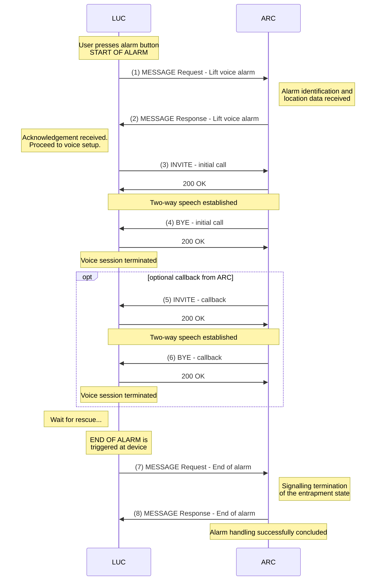
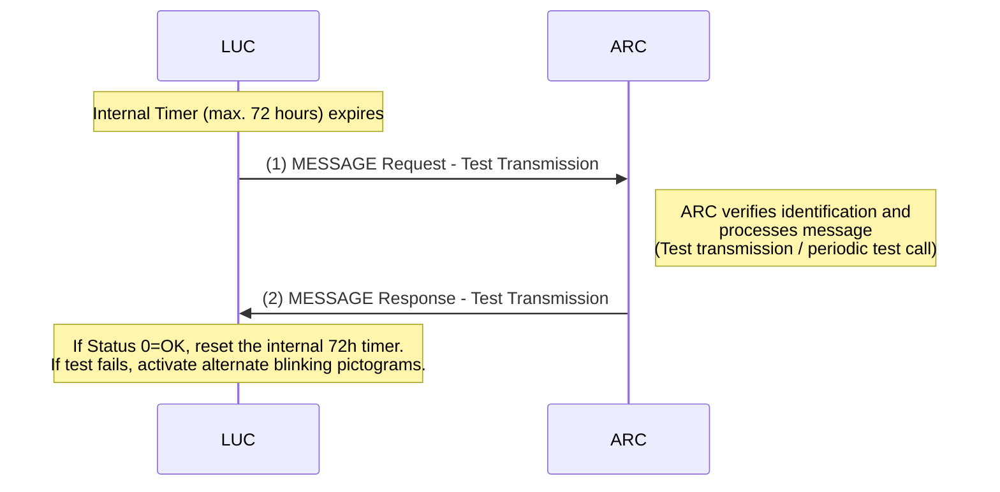
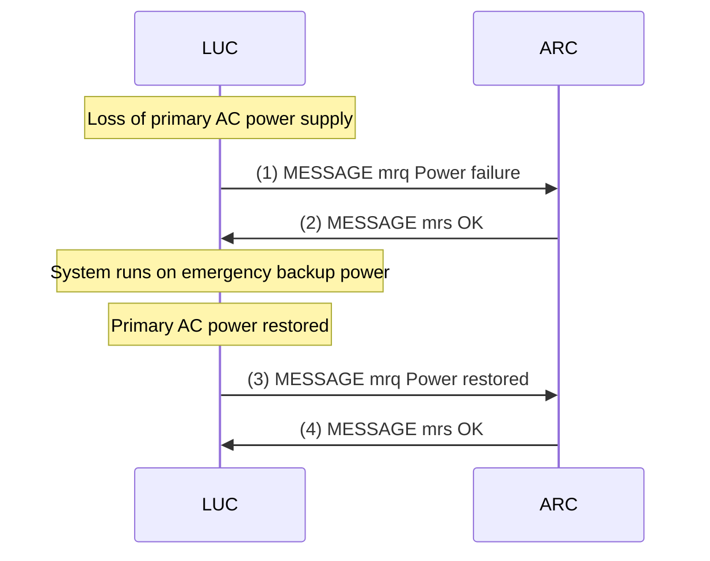
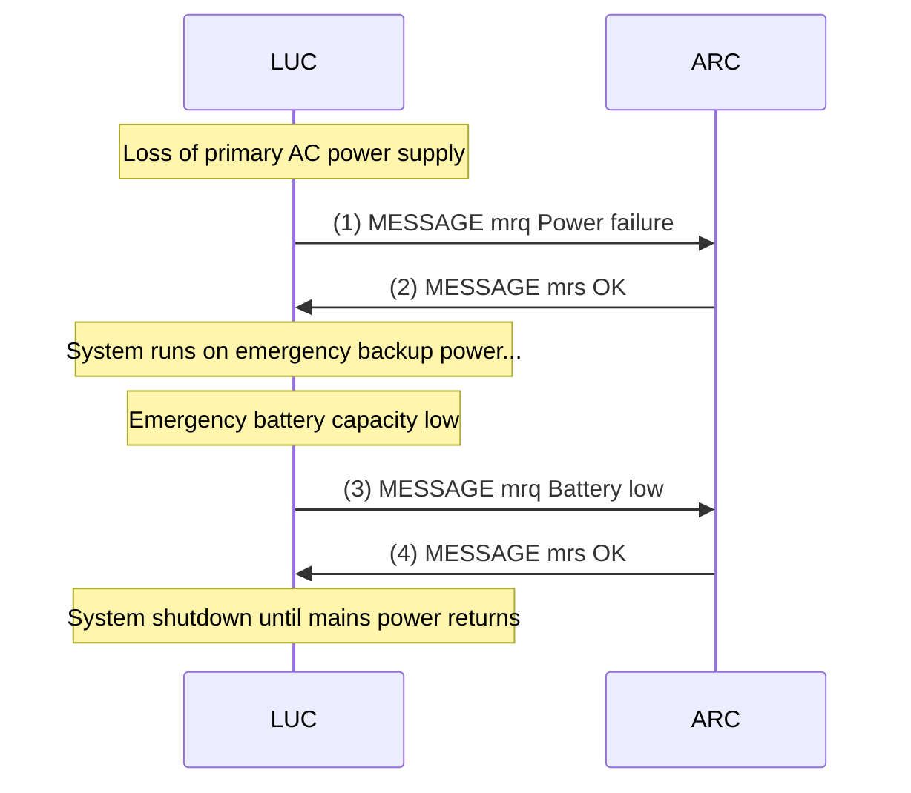
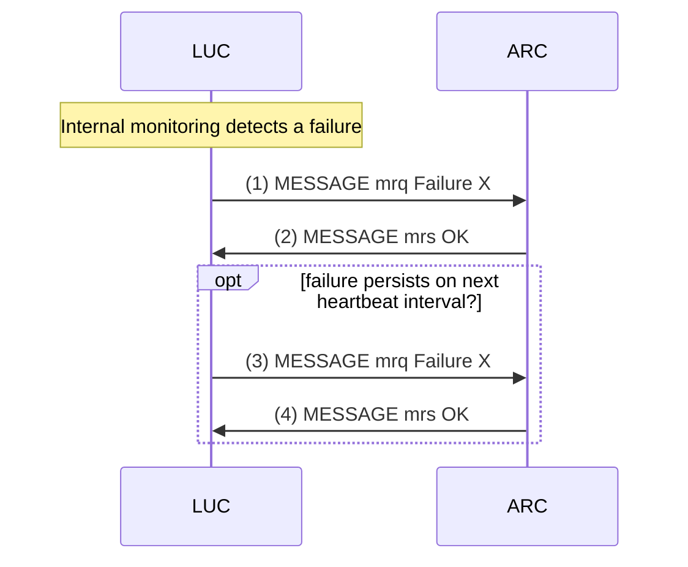
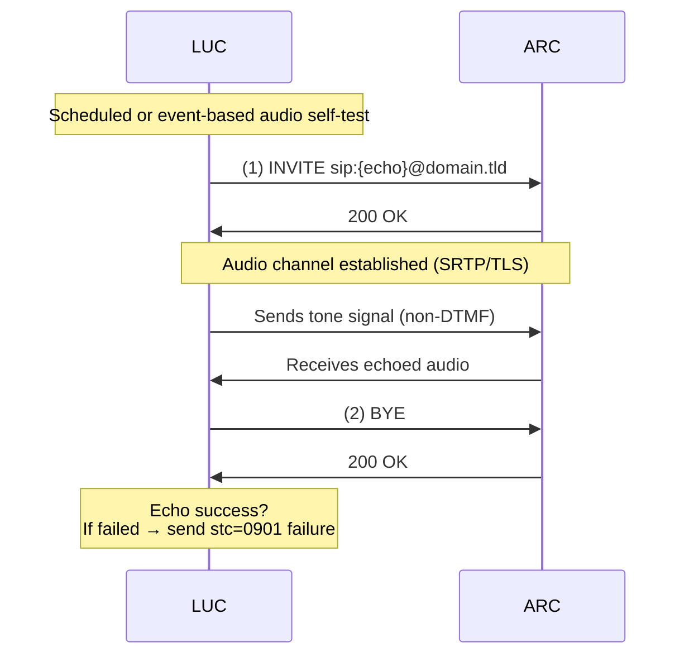
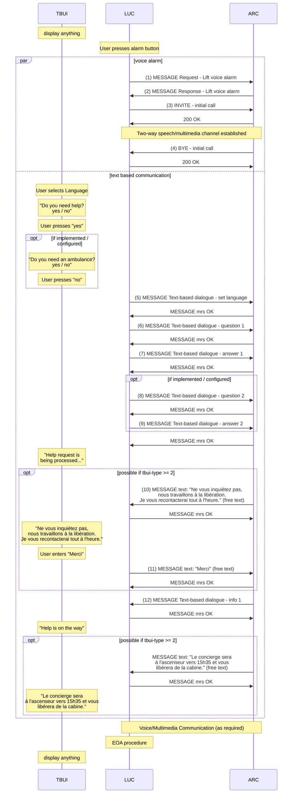
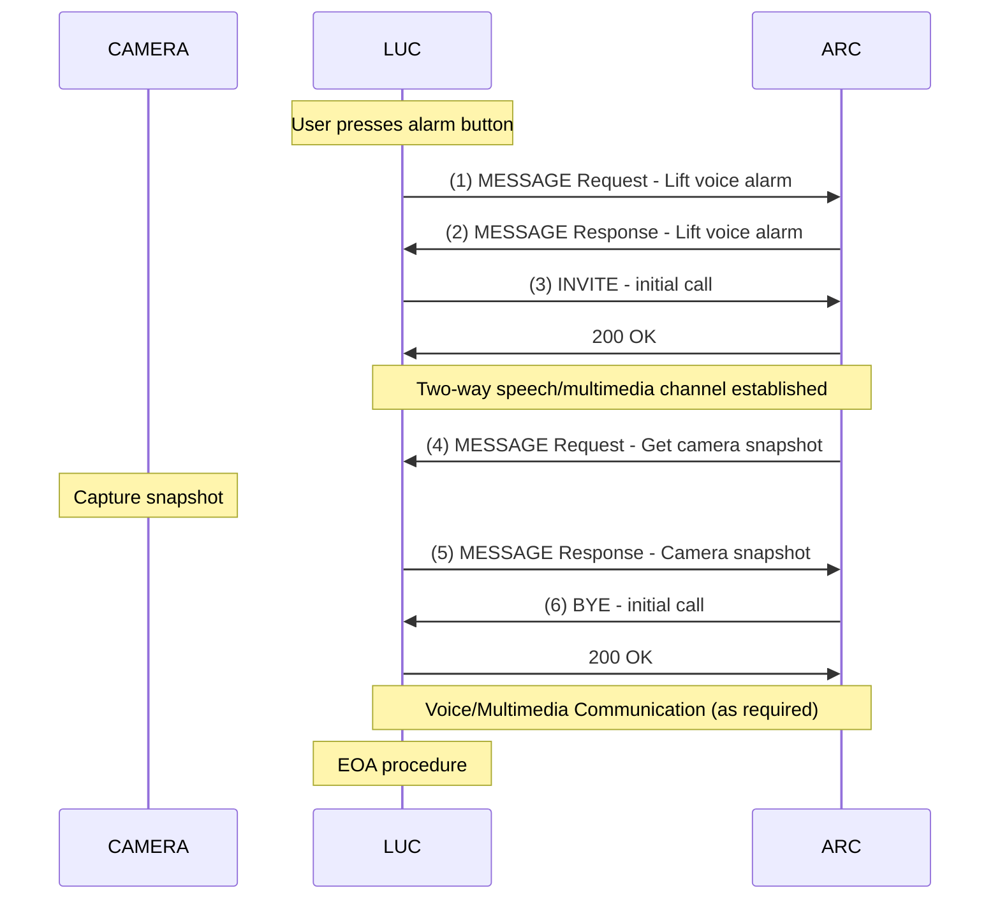

# Lift Alarm Communication Standard (LACS)

**Version:** 0.05-draft 

**Last Updated:** 2026-01-23

**Maintainer:** Telegärtner Elektronik GmbH

**Canonical Source Repository:** 
https://codeberg.org/telegaertner-elektronik/LACS-Protocol

**Contributors:**

- IOT Communications International AB

## Disclaimer - Early Draft

> [!WARNING]
>
> This document represents an early, incomplete draft of the **Lift Alarm Communication Standard (LACS)**. 
> Fundamental technical details **may change significantly** as the standard evolves. 
> Implementations based solely on this version should therefore be considered **experimental and not production-ready**.

## Licence

This documentation is published under the **Creative Commons Attribution-ShareAlike (CC BY-SA)** licence. 
You are free to use, copy, distribute, and modify this work, provided that proper attribution is given and that any derived works are released under the same licence.

We explicitly encourage **open collaboration and feedback**. If you identify inconsistencies, security concerns, or technical improvements, or if you would like to propose extensions to the current specification, please share your suggestions openly. 
The aim of LACS is to evolve transparently and to serve as an open, widely applicable communication standard for lift alarm systems.

### Additional Permissions for Standardisation Bodies

In addition to the rights granted under the Creative Commons Attribution-ShareAlike 4.0 International licence (CC BY-SA 4.0), the authors grant CEN, CENELEC, ETSI and other recognised standardisation bodies a non-exclusive, irrevocable permission  to reproduce, adapt, incorporate and publish this specification or parts of it in any formal standard, without the obligation to apply the Share-Alike requirement of CC BY-SA to the resulting standard or its derivatives.

This permission applies exclusively to the creation of formal standards and does not limit the CC BY-SA licensing that applies to all other users.

## Purpose

The purpose of this document is to standardise the practical implementation of lift alarm in accordance with EN 81-28:2022 on the basis of CLC/TS 50134-9:2018. The Information Note "Voice over IP for EN81-28 communication system" issued by the ELA TELCO WG in January 2024 is taken into account.

It also takes into account optional practical applications that go beyond the basic requirements of EN 81-28.

The supplementary specifications in this document are intended to achieve a protocol that can be implemented as universally as possible and supported by as many manufacturers and alarm receiving centres as possible.

The document also contains specific examples to facilitate implementation and avoid misunderstandings.

### Motivation

The motivation for creating this specification arises from several gaps and insufficiently specified behaviours found in the ELA Information Note and in CLC/TS 50134-9:

- Missing precise definitions regarding specific processes, message properties, and when particular codes should/may/must be used.
  Without such clarification, independent implementations would differ in critical aspects, resulting in derivatives or dialects instead of a universally applicable standard.
- Lack of a clearly defined call sequence that ensures conformity with both normative and application-specific requirements for lift alarms
- No consistent session association for all messages exchanged from the initial alarm trigger to the end of the alarm
- Insufficient coverage of relevant message types already essential in state of the art lift alarm systems, including:
  - Alarm button failure
  - Microphone/speaker failure
  - Internal bus failure
  - Communication voice failure
- No mechanism for validating bidirectional communication in the voice channel, which was previously ensured implicitly by DTMF-based protocols
- No provision for extended, asynchronous communication between LUC and ARC, necessary for features commonly implemented in modern lift alarm systems such as:
  - Text-based alarm communication
  - Camera integration and image retrieval
- No method for the LUC to announce its supported extended capabilities to the ARC (e.g., TBUI features, camera functions, ...)

## Terms, definitions and abbreviations

In addition to the definitions from TS 50134-9, we define the specific aspects in the context of lift alarm systems here.

### LACS

Lift alarm transmission protocol based on SIP + TS 50134-9 + Information Note from ELA WG TELCO with practical extensions for lift alarm, shared under a CC BY-SA licence.

### Controller

Refers to the transmission device with which data and voice can be transmitted via SIP + TS 50134-9.

### Internal Bus

Internal communication interface via which one or more local units are connected to the controller and exchange data and voice. This can be an analogue telephone connection or a digital protocol such as IP.

### Local Unit

Refers to the alarm telephone or voice unit. Each local unit has one or more alarm buttons, a microphone and a speaker connected to it. 

Several local units connected to one controller can be installed at different locations in the same lift (e.g. in the cabin, on the cabin roof or in the lift shaft) or be installed on different lifts (e.g. in groups with several lifts next to each other).

### Device Component

Components belonging to a local unit, such as:

- Alarm button
- Microphone
- Speaker
- Camera
- User interface for text-based communication (TBUI)

### TBUI

Text-based user interface that enables text alarm communication between a trapped passenger and the Alarm Receiving Centre (ARC). This text communication is a supplement to standard audio communication via voice.

A TBUI can be integrated into the Local Unit or implemented through a separate user interface component connected via the internal bus. Each TBUI must always be associated with exactly one Local Unit, and all TBUI-related messages must be transmitted within the same session context as the corresponding voice alarm. The TBUI provides predefined questions and answers, free-text input (if supported), dynamic answer options and language selection.

## Architecture


Each Controller is identified by `controller-id` (cid)

Each local unit is identified by  `controller-id`  + `device id` (cid+did)


## Basic Concepts

### Protocol Layer Model

This overview shows the communication channels and the underlying layers:

| Purpose              | SIP Signalling                                               | SCAIP XML                                        | Audio for voice alarms           | LACS XML<br />Optional                          | **JPEG Snapshot**<br />Optional                        | **Multimedia Services** *(RTT + Video, ...)<br />*Optional   |
| -------------------- | ------------------------------------------------------------ | ------------------------------------------------ | -------------------------------- | ----------------------------------------------- | ------------------------------------------------------ | ------------------------------------------------------------ |
| **7 – Application**  | SIP, SDP                                                     | SIP MESSAGE with `application/`<br />`scaip+xml` | RTP payloads: G.711 A-law, G.729 | SIP MESSAGE with `application/`<br />`lacs+xml` | multipart MIME (`application/`<br />`lacs+xml` + JPEG) | T.140 (RFC 4103), RTP video payloads (H.264/H.265 or similar) |
| **6 – Presentation** | TLS ≥ 1.2, X.509 certificates, Digest Authentication (RFC 7616) | TLS ≥ 1.2, X.509 certificates                    | SRTP (AES-128 minimum)           | TLS ≥ 1.2, X.509 certificates                   | JPEG base64 inside multipart                           | SRTP (AES-128 minimum)                                       |
| **5 – Session**      | SIP dialog layer; authentication via SIP Digest (RFC 7616)   | SCAIP model (`ref`, `asid`)                      | RTP/SDP session                  | LACS model (`ref`, `asid`)                      | snapshot request session (`ref`)                       | RTP/SDP session                                              |
| **4 – Transport**    | TCP/TLS (default) or UDP                                     | SIP MESSAGE transport                            | UDP (RTP/RTCP)                   | SIP MESSAGE transport                           | SIP MESSAGE transport                                  | UDP (RTP/RTCP)                                               |
| **3 – Network**      | IPv4 / IPv6                                                  | IPv4 / IPv6                                      | IPv4 / IPv6                      | IPv4 / IPv6                                     | IPv4 / IPv6                                            | IPv4 / IPv6                                                  |

### LUC Configuration

Settings and information that must be configured at Local Unit and Controller (LUC)

- SIP registration
  - SIP server address (FQDN)
  - SIP server domain
  - Username
  - Password
- SIP URI for SCAIP messages
- Fallback SIP URI for alarm voice calls (only if call to tnu number fails)
- SIP URI for echo test calls
- Interval of the test transmission in hour

### ARC Configuration

Settings and information configured in the ARC or its Alarm Management System

- There is a object with a specific controller-id + device-id with lift alarm via LACS protocol.
- Expected interval of the test transmission in hours
- Exact address / location of the object
- Information and contact details required to initiate and coordinate the rescue of passengers 
- Information and contact details to initiate service work

The ARC explicitly does not know which device type/version is installed and which separate extended functions it may support.


## Specification

To utilise the full range of LACS functions, two communication channels must be used:
- For all simple messages to the ARC that can be implemented in accordance with TS 50134-9, `Content-Type: application/scaip+xml` is used.
  (see chapters ‘Supported in scaip+xml...’)
- For advanced bidirectional communication, e.g. for TBUI and camera support, `Content-Type: application/lacs+xml` is used.
  (see chapters ‘Supported in lacs+xml...’)

### Supported in scaip+xml Message Request (mrq)

#### reference (ref)

as specified in TS 50134-9 

#### media-request (mreq)

| mreq | Description       | Defined by |
| ---- | ----------------- | ---------- |
| 1    | duplex voice call | TS 50134-9 |

For voice alarm (stc=0010) only duplex voice call (mreq=1) is supported. For all other stc the mreq is omitted.

#### message-type (mty)

| mty  | Description |
| ---- | ----------- |
| ME   | Message     |

`PI`, `RE` and `IN` are not used.

#### controller-id (cid)

as specified in TS 50134-9

#### device-type (dty)

| dty  | Description                                                  | Defined by |
| ---- | ------------------------------------------------------------ | ---------- |
| 0002 | Unified lift alarm unit and controller (TOC unit with peripherals) | TS 50134-9 |
| 0032 | Communication link monitor (internal bus between Controller and Local Units) | TS 50134-9 |
| 0041 | Power supply (if it is a separated component)                | TS 50134-9 |
| 0045 | Lift alarm controller (machine room unit controlling other devices) | TS 50134-9 |
| 0100 | Top of car unit (if separated from the controller)           | ELA        |
| 0101 | In car unit / COP unit                                       | ELA        |
| 0102 | Under-car unit                                               | ELA        |
| 0110 | Pit unit                                                     | ELA        |

#### device-id (did)

as specified in TS 50134-9

#### device-component (dco)

| dco  | Description                                        | Defined by |
| ---- | -------------------------------------------------- | ---------- |
| 002  | Button 1 (Alarm Button 1)                          | TS 50134-9 |
| 003  | Button 2 (Alarm Button 2)                          | TS 50134-9 |
| 004  | Button 3 (Alarm Button 3)                          | TS 50134-9 |
| 090  | Microphone + speaker                               | LACS       |
| 091  | Camera                                             | LACS       |
| 092  | User interface for text-based communication (TBUI) | LACS       |

#### caller-id (crd)

as specified in TS 50134-9

#### status-code (stc)

| stc  | Description                                                  | Defined by |
| ---- | ------------------------------------------------------------ | ---------- |
| 0009 | Alarm triggered by the system                                | TS 50134-9 |
| 0010 | Alarm, user-triggered - always in combination with voice connection | TS 50134-9 |
| 0014 | Battery failure                                              | TS 50134-9 |
| 0015 | Battery high/full/charged                                    | TS 50134-9 |
| 0016 | Battery low                                                  | TS 50134-9 |
| 0023 | Communications link, IP, failure                             | TS 50134-9 |
| 0112 | Communications link, IP, restored                            | TS 50134-9 |
| 0024 | Comms. link, mobile, failure                                 | TS 50134-9 |
| 0113 | Comms. link mobile, restored                                 | TS 50134-9 |
| 0085 | Power failure (mains)                                        | TS 50134-9 |
| 0086 | Power restored (mains)                                       | TS 50134-9 |
| 0102 | Test transmission / periodic test call                       | TS 50134-9 |
| 0103 | Test transmission, secondary/redundant channel               | TS 50134-9 |
| 0201 | End of alarm / alert (EOA)                                   | ELA        |
| 0901 | Communication voice failure between Controller and ARC       | LACS       |
| 0902 | Alarm button failure                                         | LACS       |
| 0903 | Microphone speaker failure                                   | LACS       |
| 0904 | Internal Bus failure                                         | LACS       |

#### location-code (lco)

| lco  | Description            | Defined by |
| ---- | ---------------------- | ---------- |
| 053  | Elevator, lift car     | TS 50134-9 |
| 054  | Elevator, machine room | ELA        |
| 055  | Elevator, top of car   | ELA        |
| 056  | Elevator, pit          | ELA        |


#### alert-session-id (asid)

This is an additional property defined in LACS-Protocol, as this is currently missing in TS 50134-9.

Value of the alert-session-id is a 36 char string with an UUID according to RFC 4122. 

The alert-session-id will stay stable from start till end of an alert.

|                                                         | Start of alert<br />(first usage of unique asid) | End of alert<br />(last usage of asid)    |
| ------------------------------------------------------- | ------------------------------------------------ | ----------------------------------------- |
| Lift alarm                                              | first mrq with lift voice alarm (stc=0010)       | successful mrs on end of alarm (stc=0201) |
| Single event transmission <br />independent of an alarm | mrq                                              | successful mrs                            |

The alert-session-id must be transmitted in every MESSAGE (property `asid` in mrq and mrs). In addition, the `asid` property must also be delivered with each INVITE as a URI parameter in the `Contact` header during voice calls. This means that it is also automatically transferred as a request parameter during BYE.

The `alert-session-id` offers the following advantages:
- The `asid` provides us with a comprehensive, unique identifier for each process. Without asid, we would have to use at least a timestamp (which is not always consistent), controller-id and device-id.
- If the ARC responds to an mrq with status HOLD (snu=4), the LUC must repeat the transmission after a waiting period and also assign a new `ref`. Thanks to the consistent `asid`, the ARC can now determine that this is a repeat and not an independent event.
- The `asid` can be used to uniquely assign all related events to a lift alarm session. This includes, for example, actions in the context of a visual alarm, the retrieval of a camera image from the cabin or the end of alarm.
- The `asid` makes it significantly easier to filter related events when analysing log or trace data.

#### capabilities (cap)

comma separated list of 2 digit values

| cap value | Description                                          | Capabilities LUC => ARC                  | Capabilities <br />ARC => LUC |
| --------- | ---------------------------------------------------- | ---------------------------------------- | ----------------------------- |
| 11        | TBUI supports predefined texts                       | predefined questions + answers           | predefined info (31)          |
| 12        | TBUI supports displaying free text received from ARC |                                          | free text (00, 01)            |
| 13        | TBUI supports dynamic answers                        |                                          | dynamic answer options        |
| 14        | TBUI supports input and sending of free text         | free text (via keyboard or other method) |                               |
| 21        | CAMERA with still image (single snapshot)            | JPEG snapshot                            |                               |
| 22        | CAMERA with video stream LUC -> ARC                  | video stream                             |                               |
| 23        | CAMERA with bidirectional video stream with audio    | audio + video stream                     | audio + video stream          |
| 90-99     | Reserved for custom non standard implementations     |                                          |                               |

### Supported in SCAIP Message Response (mrs)

#### reference (ref)

as specified in TS 50134-9

#### status-number (snu)

as specified in TS 50134-9

Important note: on snu=4 the LUC has to retransmit the message with a new ref - but the alarm-session-id (asid) must stay the same

#### media-reply (mre)

| mre  | Description       | Defined by |
| ---- | ----------------- | ---------- |
| 1    | duplex voice call | TS 50134-9 |

For voice alarm (stc=0010) only duplex voice call (mreq=1) is supported. For all other stc the mre is omitted.

#### callhandling-reply (cre)

| cre  | Description                                                  | Defined by |
| ---- | ------------------------------------------------------------ | ---------- |
| 62   | set-up a voice call to transferred URI/Telephone number defined in transferred-number, <tnu> | TS 50134-9 |

The LUC must support callbacks from the ARC. But the first voice call immediately after the voice alarm (`stc`=0010) is always initiated by the LUC.

Only 62 is allowed here - so the ARC has full control regarding the call routing - if the call to the `tnu` number fails, the LUC should fall back to a predefined number

#### transferred-number (tnu)

as specified in TS 50134-9

#### alert-session-id (asid)

see above... asid must also be included in the response

### scaip+xml Request Overview

| mty  | dty                                                          | dco               | stc  | Optional |                                      |
| ---- | ------------------------------------------------------------ | ----------------- | ---- | -------- | ------------------------------------ |
| ME   | 0002 / 0100 / 0101 / <br />0102 / 0103 / 0110                |                   | 0010 |          | Lift voice alarm                     |
| ME   | 0002 / 0100 / 0101 / <br />0102 / 0103 / 0110                |                   | 0201 |          | End of Alarm                         |
| ME   | 0002 / 0041 /0045 / <br />0100 / 0101 / 0102 / <br />0103 / 0110 |                   | 0014 |          | Battery failure                      |
| ME   | 0002 / 0041 /0045 / <br />0100 / 0101 / 0102 / <br />0103 / 0110 |                   | 0015 |          | Battery high/full/recharged          |
| ME   | 0002 / 0041 /0045 / <br />0100 / 0101 / 0102 / <br />0103 / 0110 |                   | 0016 |          | Battery low                          |
| ME   | 0002 / 0041 /0045 / <br />0100 / 0101 / 0102 / <br />0103 / 0110 |                   | 0085 |          | Power failure (mains)                |
| ME   | 0002 / 0041 /0045 / <br />0100 / 0101 / 0102 / <br />0103 / 0110 |                   | 0086 |          | Power restored (mains)               |
| ME   | 0002 / 0100 / 0101 / <br />0102 / 0103 / 0110                | 002 / 003 / 004   | 0902 | X        | Alarm button failure                 |
| ME   | 0002 / 0100 / 0101 / <br />0102 / 0103 / 0110                | 090 (Mic+Speaker) | 0903 | X        | Microphone speaker failure           |
| ME   | 0032 (Comm link monitor)                                     | -                 | 0904 | X        | Internal Bus failure                 |
| ME   | 0045 (Controller)                                            |                   | 0901 | X        | Communication voice failure          |
| ME   | 0002 / 0045 / 0100 / <br />0101 / 0102 / 0103 / <br />0110   |                   | 0102 |          | Test transmission, primary channel   |
| ME   | 0002 / 0045 / 0100 / <br />0101 / 0102 / 0103 / <br />0110   |                   | 0103 |          | Test transmission, redundant channel |

### Supported in lacs+xml Message Request (mrq)

#### reference (ref)

same as in TS 50134-9

#### message-type (mty)

| mty  | Description                   |
| ---- | ----------------------------- |
| CO   | Command                       |
| TD   | TBUI dialog action or message |

#### action-id (aid)

action-id must always be interpreted in combination with `mty`

| mty  | aid            | Direction   | Description                                      |
| ---- | -------------- | ----------- | ------------------------------------------------ |
| TD   | 0100 (default) | LUC <=> ARC | Free text                                        |
| TD   | 0101           | ARC => LUC  | Free text info (no answer expected)              |
| TD   | 0109           | LUC => ARC  | Set Language                                     |
| TD   | 0111           | LUC => ARC  | Auto Question 1 "Do you need help"               |
| TD   | 0112           | LUC => ARC  | Auto Question 2 "Do you need an ambulance?"      |
| TD   | 0121           | LUC => ARC  | Answer "yes"                                     |
| TD   | 0122           | LUC => ARC  | Answer "no"                                      |
| TD   | 0131           | ARC => LUC  | Info 1 (no answer expected) "Help is on the way" |
| CO   | 0200           | ARC => LUC  | Get Camera image (snapshot)                      |

#### controller-id (cid)

same as in TS 50134-9

#### device-id (did)

same as in TS 50134-9

#### device-component (dco)

| dco  | Description                                        | Defined by |
| ---- | -------------------------------------------------- | ---------- |
| 002  | Button 1 (Alarm Button 1)                          | TS 50134-9 |
| 003  | Button 2 (Alarm Button 2)                          | TS 50134-9 |
| 004  | Button 3 (Alarm Button 3)                          | TS 50134-9 |
| 090  | Microphone + speaker                               | LACS       |
| 091  | Camera                                             | LACS       |
| 092  | User interface for text-based communication (TBUI) | LACS       |

#### alert-session-id (asid)

see definition under scaip+xml mrq

#### text (txt)

Must always be interpreted in combination with `mty` and `aid`.

Text is always encoded as UTF-8

### Supported in lacs+xml Message Response (mrs)

#### reference (ref)

same as in TS 50134-9

#### status-number (snu)

same as in TS 50134-9

Important note: on `snu`=4 the LUC has to re-transmit the message with a new ref - but the alarm-session-id (asid) must stay the same


## Use Cases

> [!WARNING]
>
> All sequence diagrams below  are rough drafts and may still contain serious errors.

###  Lift Voice Alarm




#### (1) MESSAGE Request - Lift voice alarm

```xml
MESSAGE sip:{arc-reception}@domain.tld;transport=tls
...
Content-Type: application/scaip+xml
 
<mrq>
    <ref>{ref-1}</ref>
    <mty>ME</mty>
    <mreq>1</mreq>
    <cid>{controller-id}</cid>
    <dty>0101</dty>
    <did>{device-id}</did>
    <stc>0010</stc>
    <lco>053</lco>
    <asid>{alert-session-id}</asid>
</mrq>
```

#### (2) MESSAGE Response - Lift voice alarm

```xml
MESSAGE sip:{controller-id}@domain.tld;transport=tls
...
Content-Type: application/scaip+xml
 
<mrs>
	<ref>{ref-1}</ref>
    <snu>0</snu>
    <mre>1</mre>
    <cre>62</cre>
    <tnu>sips:{arc-operator}@domain.tld</tnu>
    <asid>{alert-session-id}</asid>
</mrs>
```

#### (3) INVITE - initial call

```
INVITE sip:{arc-operator}@domain.tld;transport=tls

From: <sip:{controller-id}@domain.tld>;did={device-id}
To: <sip:{arc-operator}@domain.tld>
Contact: <sip:{controller-id}@{ip}:{port};transport=TLS;asid={alert-session-id}>
...
```

#### (4) BYE - initial call

```
BYE sip:{controller-id}@{ip}:{port};transport=TLS;asid={alert-session-id}
...
```

#### (5) INVITE - callback

```
INVITE sip:{controller-id}@domain.tld;transport=tls;did={device-id}

From: <sip:{arc-operator}@domain.tld>;did={device-id}
To: <sip:{controller-id}@domain.tld>
Contact: <sip:{arc-operator}@{ip}:{port};transport=TLS;asid={alert-session-id}>
...
```

#### (6) BYE - callback

```
BYE sip:{controller-id}@{ip}:{port};transport=TLS;asid={alert-session-id}
...
```

#### (7) MESSAGE Request - End of alarm

```xml
MESSAGE sip:{arc-reception}@domain.tld;transport=tls
...
Content-Type: application/scaip+xml
 
<mrq>
    <ref>{ref-2}</ref>
    <mty>ME</mty>
    <cid>{controller-id}</cid>
    <dty>0101</dty>
    <did>{device-id}</did>
    <stc>0201</stc>
    <lco>053</lco>
    <asid>{alert-session-id}</asid>
</mrq>
```

#### (8) MESSAGE Response - End of alarm

```xml
MESSAGE sip:{controller-id}@domain.tld;transport=tls
...
Content-Type: application/scaip+xml
 
<mrs>
	<ref>{ref-2}</ref>
    <snu>0</snu>
    <asid>{alert-session-id}</asid>
</mrs>
```

### Heartbeat - Test Transmission



#### (1) MESSAGE Request - Test Transmission

```xml
MESSAGE sip:{arc-reception}@domain.tld;transport=tls
...
Content-Type: application/scaip+xml
 
<mrq>
    <ref>{ref-1}</ref>
    <mty>ME</mty>
    <cid>{controller-id}</cid>
    <dty>0101</dty>
    <did>{device-id}</did>
    <stc>0102</stc>
    <lco>053</lco>
    <asid>{alert-session-id}</asid>
</mrq>
```

#### (2) MESSAGE Response - Test Transmission

```xml
MESSAGE sip:{controller-id}@domain.tld;transport=tls
...
Content-Type: application/scaip+xml
 
<mrs>
	<ref>{ref-1}</ref>
    <snu>0</snu>
    <asid>{alert-session-id}</asid>
</mrs>
```


### Power Outage

#### Short Power Outage

A short outage results in a **failure and a restoration message**.



#### (1) MESSAGE mrq — Power failure

```xml
MESSAGE sip:{arc-reception}@domain.tld;transport=tls
...
Content-Type: application/scaip+xml

<mrq>
    <ref>{ref-1}</ref>
    <mty>ME</mty>
    <cid>{controller-id}</cid>
    <dty>0045</dty>
    <stc>0085</stc>
    <asid>{alert-session-id}</asid>
</mrq>
```

#### (2) MESSAGE mrs — Power failure OK

```xml
MESSAGE sip:{controller-id}@domain.tld;transport=tls
...
Content-Type: application/scaip+xml

<mrs>
    <ref>{ref-1}</ref>
    <snu>0</snu>
    <asid>{alert-session-id}</asid>
</mrs>
```

#### (3) MESSAGE mrq — Power restored

```xml
MESSAGE sip:{arc-reception}@domain.tld;transport=tls
...
Content-Type: application/scaip+xml

<mrq>
    <ref>{ref-2}</ref>
    <mty>ME</mty>
    <cid>{controller-id}</cid>
    <dty>0045</dty>
    <stc>0086</stc>
    <asid>{alert-session-id}</asid>
</mrq>
```

#### (4) MESSAGE mrs — Power restored OK

```xml
MESSAGE sip:{controller-id}@domain.tld;transport=tls
...
Content-Type: application/scaip+xml

<mrs>
    <ref>{ref-2}</ref>
    <snu>0</snu>
    <asid>{alert-session-id}</asid>
</mrs>
```

#### Long Power Outage

If the mains is not restored, the emergency power supply may become critically low.
 In this case **no “power restored” message is sent**, and a **battery low** status must be transmitted before shutdown.



#### (3) MESSAGE mrq — Battery low

```xml
MESSAGE sip:{arc-reception}@domain.tld;transport=tls
...
Content-Type: application/scaip+xml

<mrq>
    <ref>{ref-3}</ref>
    <mty>ME</mty>
    <cid>{controller-id}</cid>
    <dty>0045</dty>
    <stc>0016</stc>
    <asid>{alert-session-id}</asid>
</mrq>
```

#### (4) MESSAGE mrs — Battery low ACK

```xml
MESSAGE sip:{controller-id}@domain.tld;transport=tls
...
Content-Type: application/scaip+xml

<mrs>
    <ref>{ref-3}</ref>
    <snu>0</snu>
    <asid>{alert-session-id}</asid>
</mrs>
```

### Function monitoring and failure notification

LUC should check at least on every Heartbeat:

| To be checked                                                | Comment                                                      | mrq on failure                                               |
| ------------------------------------------------------------ | ------------------------------------------------------------ | ------------------------------------------------------------ |
| Condition emergency supply for local unit(s) and controller is good and it fulfils the requirements of EN81-28 | Mandatory according to EN81-28                               | Battery failure<br />`stc` = 0014                            |
| Voice communication towards ARC works properly               | Optional - Should be checked using echo test, see section below | Communication voice failure<br />`stc` = 0901                |
| Pressing and releasing the alarm button at local unit works properly | Optional - Only possible with special hardware such as a remotely operated button | Alarm button failure<br />`dco` = 002 / 003 / 004<br />`stc` = 0902 |
| Proper functionality of microphone and loudspeaker at local unit | Optional - Audio signal played through speaker must be received by microphone at appropriate level | Microphone speaker failure<br />`dco` = 090<br />`stc` = 0903 |
| Communication link of internal bus between Local Unit(s) and Controller is available | Optional                                                     | Internal Bus failure<br />`dty` = 0032<br />`stc` = 0904     |

If a failure is detected:

1. The LUC must immediately transmit a `mrq` `MESSAGE` with the appropriate properties.
2. If the failure still persists on next check (heartbeat interval) a new message must be send with the same failure.

#### Generic Sequence diagram



------

#### Example: Battery Failure (0014)

##### (1) MESSAGE mrq - Battery failure

```xml
MESSAGE sip:{arc-reception}@domain.tld;transport=tls
...
Content-Type: application/scaip+xml

<mrq>
    <ref>{ref-1}</ref>
    <mty>ME</mty>
    <cid>{controller-id}</cid>
    <dty>0045</dty>
    <stc>0014</stc>
    <asid>{alert-session-id-1}</asid>
</mrq>
```

##### (2) MESSAGE mrs OK

```xml
MESSAGE sip:{controller-id}@domain.tld;transport=tls
...
Content-Type: application/scaip+xml

<mrs>
    <ref>{ref-1}</ref>
    <snu>0</snu>
    <asid>{alert-session-id-1}</asid>
</mrs>
```

The failure persists on next heartbeat interval.

##### (3) MESSAGE mrq - Battery failure

```xml
MESSAGE sip:{arc-reception}@domain.tld;transport=tls
...
Content-Type: application/scaip+xml

<mrq>
    <ref>{ref-2}</ref>
    <mty>ME</mty>
    <cid>{controller-id}</cid>
    <dty>0045</dty>
    <stc>0014</stc>
    <asid>{alert-session-id-2}</asid>
</mrq>
```

##### (4) MESSAGE mrs OK

```xml
MESSAGE sip:{controller-id}@domain.tld;transport=tls
...
Content-Type: application/scaip+xml

<mrs>
    <ref>{ref-2}</ref>
    <snu>0</snu>
    <asid>{alert-session-id-2}</asid>
</mrs>
```

#### SIP Echo Test Sequence



##### (1) INVITE Request — Echo Test

```
INVITE sip:{echo}@domain.tld;transport=tls SIP/2.0
From: <sip:{controller-id}@domain.tld>;did={device-id}
To: <sip:{echo}@domain.tld>
Contact: <sip:{controller-id}@{ip}:{port};transport=TLS;asid={alert-session-id}>
...
```

##### (2) BYE Request — Echo Test Termination

```
BYE sip:{echo}@domain.tld;transport=TLS;asid={alert-session-id} SIP/2.0
Via: SIP/2.0/TLS {ip}:{port};branch=z9hG4bK-bye222
From: <sip:{controller-id}@domain.tld>;did={device-id};tag=abc123
To: <sip:{echo}@domain.tld>;tag=arc987
...
```


### Text-based Alarm Communication

If the LUC has an integrated TBUI, it must inform the ARC via the `cap` property in the lift voice alarm which options the TBUI supports.

> [!IMPORTANT]
>
> If the ARC or the LUC support TBUI, they must have implemented at least the simplest variant with predefined texts (`cap` must contain `11`), which also serves as a fallback level.

As soon as a lift voice alarm in the corresponding local unit is initiated, the user must be asked question 1 (and then optionally question 2) immediately, with the answer options Yes and No.

These automated questions and their answers may only be transferred to the ARC after they have been answered, including a reference to the template (`aid`). As soon as the ARC has confirmed receipt with 200 OK, the user will see the message "Help request is being processed..." 

If the TBUI has been operated and a rescue is initiated, a ‘Help is on the way’ with aid=31 must be sent from the ARC to the LUC.

The ARC is only allowed to send free text to the LUC if the `cap` contains `12`.

#### Language Support

The TBUI must be able to display the predefined text templates in all supported languages, and the user must be able to select the appropriate language themselves.

If the user selects a different language, this language setting must be communicated to the ARC immediately if the TBUI supports receiving free text (`cap` contains `12`). This notification is sent with `aid=0109` and `txt` containing the ISO 639-1 language code

The text property for messages is always additionally transmitted in English for predefined text templates (in order to remain human-readable). For free text communication, the user's last selected language must always be used.

#### Dynamic Answers

If supported by the TBUI device (`cap` contains `13`), possible answers from the ARC can also be provided together with the free text (`aid`=`00`). This occurs within the `text` property in the following format: 

```
<Question>?<Answer 1>/../<Answer n>
```

At least 2 answer options must be provided and there must not be more than 4 answer options.

Sample:

```
How many people are in the lift?One/Two/Three/Four or more
```

#### Additional Real-time text (RTT)

In addition to the TBUI types defined here, LUC and ARC can optionally support real-time text (RTT) according to RFC 4103 in a separate SRTP channel and additionally provide this to the user.

#### Sequence Diagram




##### (1) MESSAGE Request - Lift voice alarm

```xml
MESSAGE sip:{arc-reception}@domain.tld;transport=tls
...
Content-Type: application/scaip+xml
 
<mrq>
    <ref>{ref-1}</ref>
    <mty>ME</mty>
    <mreq>1</mreq>
    <cid>{controller-id}</cid>
    <dty>0101</dty>
    <did>{device-id}</did>
    <stc>0010</stc>
    <lco>053</lco>
    <asid>{alert-session-id}</asid>
    <cap>11,12,13,14</cap>
</mrq>

```

##### (2) MESSAGE Response - Lift voice alarm

```xml
MESSAGE sip:{controller-id}@domain.tld;transport=tls
...
Content-Type: application/scaip+xml
 
<mrs>
	<ref>{ref-1}</ref>
    <snu>0</snu>
    <mre>1</mre>
    <cre>62</cre>
    <tnu>sips:{arc-operator}@domain.tld</tnu>
    <asid>{alert-session-id}</asid>
</mrs>

```

##### (3) INVITE - initial call

```
INVITE sip:{arc-operator}@domain.tld;transport=tls

From: <sip:{controller-id}@domain.tld>;did={device-id}
To: <sip:{arc-operator}@domain.tld>
Contact: <sip:{controller-id}@{ip}:{port};transport=TLS;asid={alert-session-id}>
...
```

##### (4) BYE - initial call

```
BYE sip:{controller-id}@{ip}:{port};transport=TLS;asid={alert-session-id}
...
```


##### (5) MESSAGE Text-based dialogue - set language

```xml
MESSAGE sip:{arc-reception}@domain.tld;transport=tls
...
Content-Type: application/lacs+xml
 
<mrq>
    <ref>{ref-2}</ref>
    <mty>TD</mty>
    <aid>0109</aid>
    <cid>{controller-id}</cid>
    <did>{device-id}</did>
    <dco>92</dco>
    <asid>{alert-session-id}</asid>
    <txt>fr</txt>
</mrq>

```

##### (6) MESSAGE Text-based dialogue - question 1

```xml
MESSAGE sip:{arc-reception}@domain.tld;transport=tls
...
Content-Type: application/lacs+xml
 
<mrq>
    <ref>{ref-3}</ref>
    <mty>TD</mty>
    <aid>0111</aid>
    <cid>{controller-id}</cid>
    <did>{device-id}</did>
    <dco>92</dco>
    <asid>{alert-session-id}</asid>
    <txt>Do you need help?</txt>
</mrq>

```

##### (7) MESSAGE Text-based dialogue - answer 1 

```xml
MESSAGE sip:{arc-reception}@domain.tld;transport=tls
...
Content-Type: application/lacs+xml
 
<mrq>
    <ref>{ref-4}</ref>
    <mty>TD</mty>
    <aid>0121</aid>
    <cid>{controller-id}</cid>
    <did>{device-id}</did>
    <dco>92</dco>
    <asid>{alert-session-id}</asid>
    <txt>Yes</txt>
</mrq>

```

##### (8) MESSAGE Text-based dialogue - question 2

```xml
MESSAGE sip:{arc-reception}@domain.tld;transport=tls
...
Content-Type: application/lacs+xml
 
<mrq>
    <ref>{ref-5}</ref>
    <mty>TD</mty>
    <aid>0112</aid>
    <cid>{controller-id}</cid>
    <did>{device-id}</did>
    <dco>92</dco>
    <asid>{alert-session-id}</asid>
    <txt>Do you need an ambulance?</txt>
</mrq>

```

##### (9) MESSAGE Text-based dialogue - answer 2

```xml
MESSAGE sip:{arc-reception}@domain.tld;transport=tls
...
Content-Type: application/lacs+xml
 
<mrq>
    <ref>{ref-6}</ref>
    <mty>TD</mty>
    <aid>0122</aid>
    <cid>{controller-id}</cid>
    <did>{device-id}</did>
    <dco>92</dco>
    <asid>{alert-session-id}</asid>
    <txt>No</txt>
</mrq>

```

##### (10) MESSAGE Text-based dialogue - free text

```xml
MESSAGE sip:{controller-id}@domain.tld;transport=tls
...
Content-Type: application/lacs+xml
 
<mrq>
    <ref>{ref-7}</ref>
    <mty>TD</mty>
    <aid>0100</aid>
    <cid>{controller-id}</cid>
    <did>{device-id}</did>
    <dco>92</dco>
    <asid>{alert-session-id}</asid>
    <txt>Ne vous inquiétez pas, nous travaillons à la libération. Je vous recontacterai tout à l'heure.</txt>
</mrq>

```

##### (11) MESSAGE Text-based dialogue - free text

```xml
MESSAGE sip:{arc-reception}@domain.tld;transport=tls
...
Content-Type: application/lacs+xml
 
<mrq>
    <ref>{ref-8}</ref>
    <mty>TD</mty>
    <aid>0100</aid>
    <cid>{controller-id}</cid>
    <did>{device-id}</did>
    <dco>92</dco>
    <asid>{alert-session-id}</asid>
    <txt>Merci</txt>
</mrq>

```

##### (12) MESSAGE Text-based dialogue - info 1

```xml
MESSAGE sip:{controller-id}@domain.tld;transport=tls
...
Content-Type: application/lacs+xml
 
<mrq>
    <ref>{ref-9}</ref>
    <mty>TD</mty>
    <aid>0131</aid>
    <cid>{controller-id}</cid>
    <did>{device-id}</did>
    <dco>92</dco>
    <asid>{alert-session-id}</asid>
    <txt>Help is on the way</txt>
</mrq>

```


### Camera support

Variants of camera support:

| cap value | Description                                       | Implementation                                               |
| --------- | ------------------------------------------------- | ------------------------------------------------------------ |
| 21        | CAMERA with still image (single snapshot)         | JPEG image as multipart SIP response see below               |
| 22        | CAMERA with video stream LUC -> ARC               | SDP + INVITE + SRTP - one stream with muted audio                 |
| 23        | CAMERA with bidirectional video stream with audio | SDP + INVITE + SRTP - two streams with audio - <br /> can be switched during session with REINVITE |


#### Single Snapshot

> [!IMPORTANT]
>
> **JPEG Size Limitation**
>
> The JPEG image included in the multipart response must not exceed 1 MiB (1 048 576 bytes) in its binary form.
> Due to Base64 expansion (4/3), the maximum size of the Base64-encoded JPEG payload is 1 398 102 bytes.
> The LUC must ensure that the Base64-encoded block does not exceed this limit.




##### (1) MESSAGE Request - Lift voice alarm

```xml
MESSAGE sip:{arc-reception}@domain.tld;transport=tls
...
Content-Type: application/scaip+xml
 
<mrq>
    <ref>{ref-1}</ref>
    <mty>ME</mty>
    <mreq>1</mreq>
    <cid>{controller-id}</cid>
    <dty>0101</dty>
    <did>{device-id}</did>
    <stc>0010</stc>
    <lco>053</lco>
    <asid>{alert-session-id}</asid>
    <cap>21</cap>
</mrq>

```

##### (2) MESSAGE Response - Lift voice alarm

```xml
MESSAGE sip:{controller-id}@domain.tld;transport=tls
...
Content-Type: application/scaip+xml
 
<mrs>
	<ref>{ref-1}</ref>
    <snu>0</snu>
    <mre>1</mre>
    <cre>62</cre>
    <tnu>sips:{arc-operator}@domain.tld</tnu>
    <asid>{alert-session-id}</asid>
</mrs>

```

##### (3) INVITE - initial call

```
INVITE sip:{arc-operator}@domain.tld;transport=tls

From: <sip:{controller-id}@domain.tld>;did={device-id}
To: <sip:{arc-operator}@domain.tld>
Contact: <sip:{controller-id}@{ip}:{port};transport=TLS;asid={alert-session-id}>
...
```

##### (4) MESSAGE Request - Get camera snapshot

```xml
MESSAGE sip:{controller-id}@domain.tld; transport=tls; did={device-id}

...
Content-Type: application/lacs+xml

<mrq>
    <ref>{ref}</ref>
    <mty>CO</mty>
    <aid>0200</aid>
    <cid>{controller-id}</cid>
    <did>{device-id}</did>
    <asid>{alert-session-id}</asid>
</mrq>
```

##### (5) MESSAGE Response - Camera snapshot

```xml
MESSAGE sip:{arc-reception}@domain.tld; transport=tls

...
Content-Type: multipart/mixed; boundary="lacs-boundary-001"
Content-Length: 123456

--lacs-boundary-001
Content-Type: application/lacs+xml; charset=utf-8
Content-Transfer-Encoding: 8bit

<mrs>
	<ref>{ref}</ref>
	<snu>0</snu>
</mrs>

--lacs-boundary-001
Content-Type: image/jpeg
Content-Transfer-Encoding: base64

{base64-encoded-JPEG}

--lacs-boundary-001--
```

##### (6) BYE - initial call

```
BYE sip:{controller-id}@{ip}:{port};transport=TLS;asid={alert-session-id}
...
```
